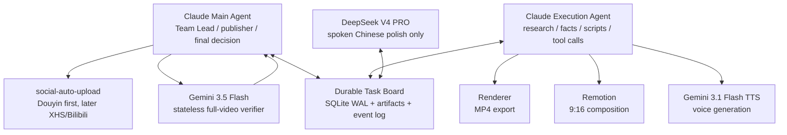

# OSS Radar Tech Channel Runtime - Tech Spec, MVP, Roadmap

> Source pack: `oss_radar_eval.agent.final/oss_radar_eval.agent.final.md`
> Target: low-load daily tech-channel production for Douyin-first distribution.
> Date: 2026-05-28

## 1. Product Goal

Build a durable agent-team runtime that turns OSS / AI tool signals into one publishable short video per day.

The system is not a generic news aggregator. Its job is to produce a "technology buyer intelligence" channel:

- what is new;
- why it matters;
- who should use it;
- who should skip it;
- what can be demonstrated in 45-60 seconds;
- whether it is safe enough to publish as a claim-sensitive video.

The key business constraint is low human load. The user should review the final candidate, blocked review issues, and channel metrics, not manually watch and rewrite every full video.

## 2. Non-Goals

- No fully autonomous publishing before the prepublish gate is stable.
- No cookie/session/proxy-based platform posting as the default path.
- No claim-light "tech news broadcast" content.
- No generic README summaries.
- No all-platform distribution in MVP.
- No persistent Gemini 3.5 Flash worker. Gemini 3.5 Flash is a stateless final gate.
- No separate TTS/Remotion/rendering teammates in MVP. Claude Execution Agent calls those tools directly.

## 3. Existing Evidence

The local evaluation report gives three design constraints:

1. No single open-source project satisfies both multi-source scanning and five-dimensional commercial scoring.
2. The best data strategy is layered composition: `mcp_server_trending`, `news-aggregator-skill`, `newsnow`, and self-developed fetchers.
3. The scoring engine must be self-built around recency, demo availability, pain-point strength, ad proximity, and fact credibility.

This spec keeps those constraints but adds the missing production layer: script generation, TTS, Remotion rendering, multimodal review, and platform publishing.

## 4. Runtime Model

Use an "agent team" model with a durable task board. Persistent coordination is only required among:

- Claude Main Agent
- Claude Execution Agent
- DeepSeek Polish Agent

Gemini 3.5 Flash is a stateless prepublish verifier. Gemini TTS and Remotion are tools called by Claude Execution Agent.



## 5. Component Responsibilities

### 5.1 Claude Main Agent

Owns orchestration and business decisions.

Responsibilities:

- create daily run;
- select final candidate from ranked radar items;
- create and assign tasks on the task board;
- enforce gates;
- call Gemini 3.5 Flash for final video review;
- publish through `social-auto-upload` only after `prepublish_review_passed`;
- write revision tasks when a gate fails;
- collect post metrics and write learning signals.

Does not:

- directly polish scripts;
- directly call Remotion in MVP;
- mutate generated artifacts without a task event;
- bypass Gemini prepublish review.

### 5.2 Claude Execution Agent

Owns evidence, structure, and media production.

Responsibilities:

- run source fetchers and scoring pipeline;
- generate facts pack;
- write structured script;
- fact-check polished script;
- call Gemini 3.1 Flash TTS;
- call Remotion render;
- export final MP4 and artifact manifest;
- write render quality metadata.

Does not:

- publish;
- change platform publishing state;
- accept DeepSeek-added facts without fact check.

### 5.3 DeepSeek Polish Agent

Owns Chinese spoken rhythm.

Responsibilities:

- claim `polish_script` tasks;
- transform structured script into 180-240 Chinese characters for 45-60 seconds;
- keep one clear judgment;
- preserve all factual claims and caveats.

Hard constraints:

- may not add new product claims;
- may not add numbers not present in the facts pack;
- may not remove "who should skip it" if present;
- must output a diff-style change summary.

### 5.4 Gemini 3.5 Flash Verifier

Stateless gate, not a runtime.

Input:

- final MP4;
- final script;
- facts pack;
- claim ledger;
- render manifest.

Output:

- structured JSON verdict;
- blocking issues;
- required fixes;
- publish-ready boolean.

It does not claim tasks, store state, or communicate with other agents. The Claude Main Agent writes the verdict back to the task board.

## 6. System Layers

### 6.1 Data Layer

MVP sources:

- GitHub Trending
- Hacker News
- Product Hunt
- Hugging Face
- arXiv AI / ML / CL
- V2EX
- 36Kr / Chinese tech feed where stable

Roadmap sources:

- newsnow-derived Chinese hot lists: Zhihu, Bilibili, Juejin, Linux.do
- Reddit / X via official APIs where available
- WaytoAGI, Jike AI groups, AI product directories
- sponsor/affiliate-adjacent sources for monetization mapping

Fetcher contract:

```json
{
  "source": "github_trending",
  "source_item_id": "owner/repo",
  "url": "https://github.com/owner/repo",
  "title": "repo name",
  "summary": "raw source summary",
  "published_at": "2026-05-28T09:00:00Z",
  "collected_at": "2026-05-28T10:00:00Z",
  "metrics": {
    "stars": 1234,
    "forks": 88,
    "comments": null,
    "upvotes": null
  },
  "raw": {}
}
```

### 6.2 Scoring Layer

Five dimensions:

| Dimension | Weight | Purpose |
| --- | ---: | --- |
| Recency | 20% | Is it early enough to matter today? |
| Demo availability | 25% | Can it become a 45-60 second visual video? |
| Pain-point strength | 25% | Is there a concrete user problem? |
| Ad proximity | 15% | Is the audience commercially valuable without being pure ad spam? |
| Fact credibility | 15% | Can the claims survive public publishing? |

Candidate threshold:

- `opportunity_score >= 7.2`
- `demo_availability >= 7`
- `fact_credibility >= 6.5`
- no `blocking_claim_risk`

Top daily candidate selection:

- Rank by weighted score.
- Prefer items with a concrete demo and a buyer/use-case angle.
- Penalize pure launch announcements without usage evidence.
- Penalize items that require heavy manual testing before a simple video can be made.

### 6.3 Content Layer

The content unit is not "news"; it is a claim-bounded buyer judgment.

Required script sections:

1. Hook: one direct judgment in the first 3 seconds.
2. Problem: what workflow pain it touches.
3. Demo: what can be shown visually.
4. Buyer judgment: who should use it.
5. Caveat: who should skip it / what is unproven.
6. Comment hook: one question to collect audience intent.

Length:

- default: 45-60 seconds;
- script target: 180-240 Chinese characters;
- hard max: 65 seconds unless weekly deep-dive format.

### 6.4 Media Layer

Claude Execution Agent calls:

- Gemini 3.1 Flash TTS for voice;
- Remotion for video composition;
- local renderer for MP4 export.

MVP Remotion templates:

1. `repo_radar`: GitHub repo / OSS project.
2. `tool_judgment`: AI tool / SaaS / Product Hunt item.
3. `paper_to_product`: paper/model/framework translated into user impact.

Artifact outputs:

- `facts_pack.json`
- `candidate_score.json`
- `structured_script.json`
- `spoken_script.md`
- `claim_ledger.json`
- `tts_audio.wav`
- `render_manifest.json`
- `video.mp4`
- `prepublish_verdict.json`
- `publish_log.json`
- `metrics_24h.json`

## 7. Durable Task Board

Use SQLite WAL in MVP. The database is the shared context. Agents should not rely on chat context for state.

### 7.1 Tables

```sql
CREATE TABLE runs (
  run_id TEXT PRIMARY KEY,
  topic_date TEXT NOT NULL,
  status TEXT NOT NULL,
  selected_candidate_id TEXT,
  current_gate TEXT,
  created_at TEXT NOT NULL,
  updated_at TEXT NOT NULL
);

CREATE TABLE tasks (
  task_id TEXT PRIMARY KEY,
  run_id TEXT NOT NULL,
  kind TEXT NOT NULL,
  status TEXT NOT NULL,
  assigned_runtime TEXT NOT NULL,
  claimed_by TEXT,
  lease_until TEXT,
  depends_on TEXT,
  input_json TEXT,
  output_json TEXT,
  created_at TEXT NOT NULL,
  updated_at TEXT NOT NULL
);

CREATE TABLE events (
  event_id TEXT PRIMARY KEY,
  run_id TEXT NOT NULL,
  task_id TEXT,
  actor TEXT NOT NULL,
  type TEXT NOT NULL,
  payload_json TEXT NOT NULL,
  created_at TEXT NOT NULL
);

CREATE TABLE artifacts (
  artifact_id TEXT PRIMARY KEY,
  run_id TEXT NOT NULL,
  type TEXT NOT NULL,
  path TEXT NOT NULL,
  sha256 TEXT NOT NULL,
  producer TEXT NOT NULL,
  version INTEGER NOT NULL,
  created_at TEXT NOT NULL
);

CREATE TABLE gates (
  gate_id TEXT PRIMARY KEY,
  run_id TEXT NOT NULL,
  gate_type TEXT NOT NULL,
  status TEXT NOT NULL,
  judge TEXT NOT NULL,
  verdict_json TEXT,
  created_at TEXT NOT NULL,
  updated_at TEXT NOT NULL
);
```

### 7.2 Task Kinds

- `scan_sources`
- `score_candidates`
- `select_candidate`
- `build_facts_pack`
- `write_structured_script`
- `polish_script`
- `fact_check_script`
- `generate_tts`
- `render_video`
- `prepublish_review`
- `revise_script`
- `revise_render`
- `publish_video`
- `collect_metrics`
- `update_learning_signals`

## 8. Daily State Machine

```text
run_created
-> sources_scanned
-> candidates_scored
-> candidate_selected
-> facts_ready
-> structured_script_ready
-> polished_script_ready
-> final_script_checked
-> audio_ready
-> video_rendered
-> prepublish_review_passed
-> published
-> metrics_collected
-> learning_updated
```

Failure transitions:

- `prepublish_review_failed -> revise_script` when fact/script issue.
- `prepublish_review_failed -> revise_render` when subtitle/audio/visual issue.
- `fact_check_failed -> polish_script` when DeepSeek added unsupported wording.
- `render_failed -> render_video` after template/tool fix.
- `publish_failed -> publish_video` only if retryable platform error.

## 9. Gate Definitions

### 9.1 Candidate Gate

Pass if:

- one clear buyer/use-case angle;
- score threshold met;
- source URL is available;
- no obvious source duplication;
- video can be made without manual research exceeding 30 minutes.

### 9.2 Script Fact Gate

Pass if:

- all claims appear in facts pack or source URLs;
- all numerical claims are source-attributed;
- no unsupported benchmark, revenue, popularity, or adoption claim;
- "inference" and "verified fact" are separated.

### 9.3 Render Gate

Pass if:

- 9:16 MP4 exported;
- length 45-60 seconds by default;
- audio file present and non-zero;
- subtitles exist and match final script;
- visual text is readable on mobile.

### 9.4 Prepublish Gate

Gemini 3.5 Flash must return:

```json
{
  "publish_ready": true,
  "blocking_issues": [],
  "scores": {
    "hook": 8,
    "factual_safety": 9,
    "spoken_clarity": 8,
    "subtitle_sync": 8,
    "visual_legibility": 8,
    "audio_quality": 8,
    "platform_risk": 8
  },
  "required_fixes": [],
  "final_reason": "Ready to publish."
}
```

Hard pass criteria:

- `factual_safety >= 9`
- `spoken_clarity >= 8`
- `subtitle_sync >= 8`
- `visual_legibility >= 8`
- no blocking issue

## 10. MVP Design

### 10.1 MVP Objective

Produce and publish one Douyin-ready tech-buyer short video per day from a scanned OSS / AI-tool candidate, with durable artifacts and a final multimodal gate.

### 10.2 MVP Scope

Included:

- local SQLite task board;
- daily CLI runner;
- 5-7 source fetchers;
- five-dimensional scoring JSON;
- Claude Main Agent orchestration;
- Claude Execution Agent production tasks;
- DeepSeek spoken-script polish;
- Gemini 3.1 Flash TTS call;
- Remotion render call;
- Gemini 3.5 Flash stateless final review;
- `social-auto-upload` Douyin publishing;
- 24h metrics import as JSON.

Excluded:

- XHS and Bilibili publishing;
- permanent dashboard;
- PostgreSQL;
- multi-user auth;
- real-time queue service;
- automated sponsor outreach;
- full self-evolution of prompts.

### 10.3 MVP Directory Layout

```text
oss-radar-channel/
  package.json
  remotion/
    templates/
      repo_radar/
      tool_judgment/
      paper_to_product/
  runtime/
    board.sqlite
    artifacts/
      YYYY-MM-DD/
        run_id/
    events.jsonl
  src/
    cli/
      daily.ts
      publish.ts
      collect-metrics.ts
    agents/
      main-agent.ts
      execution-agent.ts
      deepseek-polisher.ts
    fetchers/
      github-trending.ts
      hacker-news.ts
      product-hunt.ts
      huggingface.ts
      arxiv.ts
      v2ex.ts
      tech-cn.ts
    scoring/
      score-candidate.ts
      dedupe.ts
      fact-credibility.ts
    media/
      tts-gemini.ts
      render-remotion.ts
      verify-gemini.ts
    publishing/
      social-auto-upload.ts
    db/
      schema.sql
      board.ts
```

### 10.4 MVP Commands

```bash
npm run radar:daily
npm run radar:render -- --run-id <run_id>
npm run radar:review -- --run-id <run_id>
npm run radar:publish -- --run-id <run_id>
npm run radar:metrics -- --run-id <run_id>
```

### 10.5 MVP Acceptance Criteria

MVP is accepted when:

- daily run creates a durable `run_id`;
- at least 30 raw candidates are collected from 5+ sources;
- top 5 candidates have valid five-dimensional scoring JSON;
- one candidate is selected with a claim ledger;
- DeepSeek returns a polished spoken script without unsupported new claims;
- Claude fact gate catches unsupported DeepSeek additions in a test fixture;
- Gemini TTS creates audio;
- Remotion creates a 9:16 MP4 under 65 seconds;
- Gemini 3.5 Flash returns structured verdict JSON;
- blocked verdict creates a revision task;
- passed verdict allows Douyin publish;
- publish log and 24h metrics are stored under artifacts.

## 11. Roadmap

### Phase 0: Spec Freeze and Repo Setup (1-2 days)

Deliverables:

- choose repo root;
- initialize TypeScript runtime;
- add SQLite schema;
- add artifact manifest format;
- add `.env.example`;
- define model/provider config.

Exit criteria:

- `npm run typecheck` passes;
- task board can create a run and task;
- artifact writer creates sha256 manifest.

### Phase 1: Data + Scoring MVP (3-5 days)

Deliverables:

- implement 5-7 fetchers;
- normalize raw items;
- dedupe by URL/title/similarity;
- implement five-dimensional scoring;
- generate daily candidate report.

Exit criteria:

- 30+ candidates collected in one run;
- top 5 scored with evidence;
- one candidate selected automatically and explainably.

### Phase 2: Script + Agent Team MVP (4-6 days)

Deliverables:

- Claude Main Agent task creation;
- Claude Execution Agent facts pack and structured script;
- DeepSeek polish task;
- Claude script fact gate;
- claim ledger.

Exit criteria:

- a selected candidate produces a final script;
- unsupported DeepSeek additions are rejected;
- one clear buyer judgment exists in the first 3 seconds.

### Phase 3: Media Production MVP (4-7 days)

Deliverables:

- Gemini TTS integration;
- three Remotion templates;
- render manifest;
- subtitle sync generation;
- local video export.

Exit criteria:

- 9:16 MP4 under 65 seconds;
- audio/subtitle/video artifacts registered;
- visual text legible on mobile viewport.

### Phase 4: Prepublish Gate + Douyin Publish (3-5 days)

Deliverables:

- Gemini 3.5 Flash full-video verifier;
- blocking issue routing;
- `social-auto-upload` Douyin integration;
- publish log.

Exit criteria:

- failed verdict creates revision task;
- passed verdict publishes;
- publish result persisted.

### Phase 5: Metrics + Learning Loop (3-5 days)

Deliverables:

- 2h/24h/72h metric import;
- per-video metrics JSON;
- prompt/data learning report;
- weekly strategy review.

Exit criteria:

- system records view, completion, like, comment, favorite, share, profile-click, private-message where available;
- top-performing dimensions are visible;
- next-week candidate ranking can include prior performance.

### Phase 6: Distribution Expansion (1-2 weeks)

Add only after Douyin daily loop is stable.

Order:

1. Xiaohongshu: convert each video into saveable note or short video variant.
2. Bilibili: weekly 3-5 minute compilation, not daily mirror at first.
3. X/Twitter: optional text thread for repo-to-X workflow reuse.

### Phase 7: Monetization Readiness (2-4 weeks)

Deliverables:

- media kit from actual metrics;
- sponsor category mapping;
- product/affiliate disclosure policy;
- ad-safety rubric;
- sponsor brief intake form.

Exit criteria:

- 30-60 videos published;
- at least three repeatable content clusters with positive saves/comments;
- clear audience category for AI tools, developer tools, SaaS, training, or cloud providers.

## 12. Risk Register

| Risk | Impact | Mitigation |
| --- | --- | --- |
| Data source breaks | No candidates | per-fetcher health check, source fallback, raw error events |
| Generic summaries | Weak audience signal | require buyer judgment and skip/use split |
| DeepSeek adds unsupported claims | Fact risk | Claude fact gate + claim ledger |
| TTS mispronounces technical names | Low trust | glossary, pronunciation overrides, Gemini review |
| Remotion template looks repetitive | Audience fatigue | three MVP templates, weekly template review |
| Gemini verifier false-pass | Publishing risk | strict JSON rubric, sample manual audit every week |
| Platform upload fails | Operational delay | retryable publish tasks, no state mutation until confirmed |
| Human load grows | Strategy failure | only surface blocked issues and final candidate shortlist |

## 13. Build Order

Recommended first implementation order:

1. SQLite board + artifact manifest.
2. Source fetchers + scoring report.
3. Claude Execution Agent facts pack + structured script.
4. DeepSeek polish contract.
5. Script fact gate.
6. TTS + Remotion render for one template.
7. Gemini 3.5 Flash prepublish JSON gate.
8. Douyin publish command.
9. Metrics import.

Do not start with a dashboard. The first valuable surface is the daily artifact folder plus a concise run report.

## 14. Definition of Done

The system is done for MVP when it can run for seven consecutive days and produce:

- seven selected candidates;
- seven facts packs;
- seven final scripts;
- seven rendered videos;
- seven Gemini prepublish verdicts;
- at least five published Douyin videos;
- seven 24h metric files;
- one weekly learning report showing which scoring dimensions predicted positive feedback.
