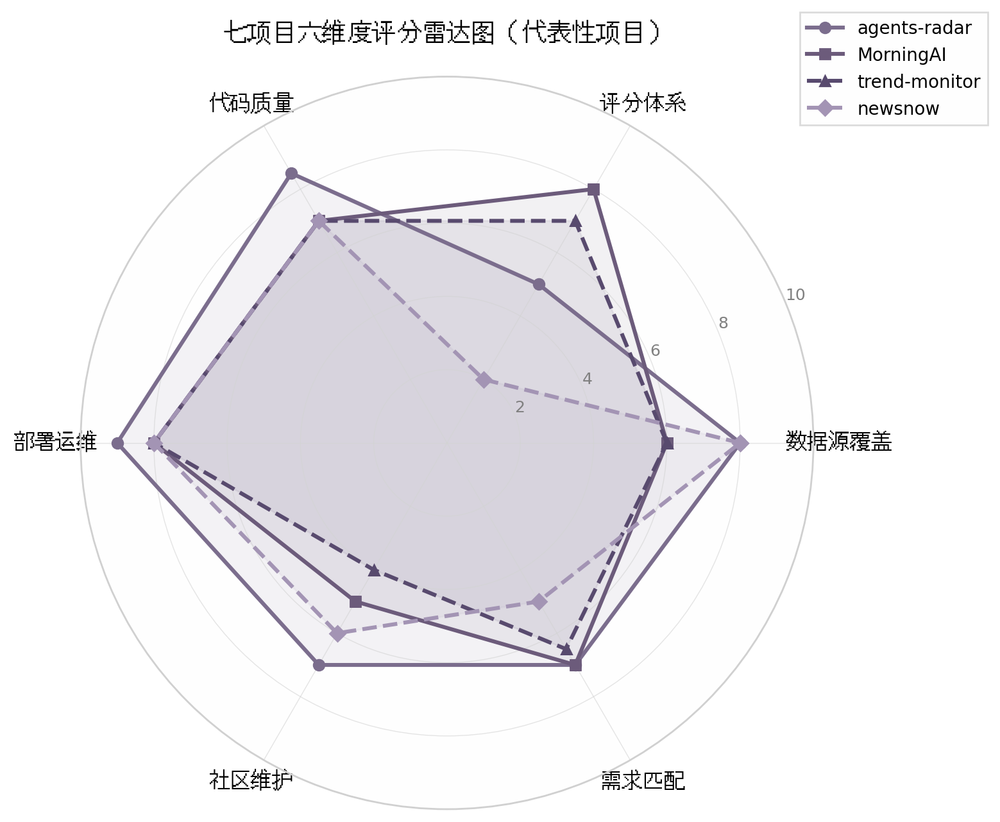
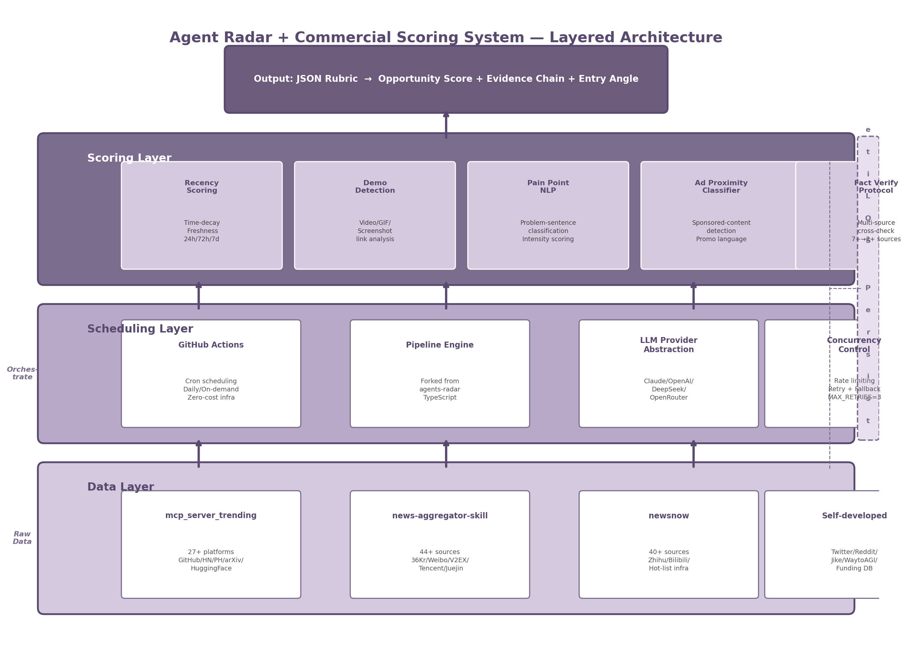

# 开源项目深度评测报告：Agent 扫源 + 商业化评分系统

> 调研日期：2026-05-28 | 评测维度：数据源覆盖、评分体系、代码质量、部署运维、社区维护、需求匹配度 | 评测项目数：7

---

## 执行摘要

本次评测对七个与"Agent 自动扫源 + 商业化评分"相关的开源项目进行了六维度深度评估。核心结论是：**没有任何单一项目同时满足"多源覆盖"与"五维商业化评分"的双重需求**，最佳策略是"组合借鉴 + 自研评分引擎"。

**综合排名**：agents-radar（7.55分）> MorningAI（7.00分）> ai-intelligence-hub（6.70分）> news-aggregator-skill（6.50分）= trend-monitor（6.50分）> newsnow（6.15分）> mcp_server_trending（5.50分）。

agents-radar 凭借工程架构（8.5分）和部署运维（9.0分）的卓越表现成为总分第一，但其评分体系完全缺失（5.0分）。MorningAI 以 8.0 分的评分体系维度得分在所有项目中最高，其两阶段评分架构（程序化量化 + Agent 定性评估）和混合相似度多源验证机制是最具复用价值的设计资产，但社区规模极小（12 stars）。

**推荐采用分层组合架构**：数据层融合 mcp_server_trending（27+国际源）、news-aggregator-skill（44+信源含国内）和 newsnow（40+中文热榜）；调度层以 agents-radar 的 GitHub Actions Pipeline 为骨架；评分层自研五维引擎（新鲜度、可演示性、痛点强度、广告邻近度、事实可信度），融合 MorningAI 的评分逻辑与 trend-monitor 的 Domain-aware 分析框架。预计分三阶段推进，总周期 4–7 周。

---

## 1. 评测背景与方法论

### 1.1 评测目标

#### 1.1.1 寻找覆盖多平台动态的开源项目

开源情报（Open Source Intelligence, OSINT）自动化聚合领域在过去18个月出现显著增长。GitHub Trending、Hacker News（HN）、Product Hunt、Hugging Face、arXiv、X 及国内社区已成为技术趋势发布的主要阵地。本次评测旨在系统性识别能自动化覆盖上述信息源的开源项目。截至2026年5月28日，七个项目进入深度评测：agents-radar（767 stars） [(来源)](about:blank) 、MorningAI（12 stars） [(GitHub - duanyytop/agents-radar: Daily AI ecosystem digest from 10 sources (GitHub, ArXiv, HN, HuggingFace, Product Hunt, Dev.to, Lobste.rs). Bilingual ZH/EN reports via GitHub Actions. · GitHub)](https://github.com/duanyytop/agents-radar) 、mcp_server_trending（2 stars） [(GitHub - octo-patch/MorningAI: AI news tracking skill for Agents like Claude Code, Openclaw, and more. Tracks AI entities across 9 sources and generates daily structured reports. · GitHub)](https://github.com/octo-patch/MorningAI) 、news-aggregator-skill（1.1k stars） [(GitHub - Talljack/mcp_server_trending: Trending charts that independent developers care about. · GitHub)](https://github.com/Talljack/mcp_server_trending) 、trend-monitor（6 stars） [(agents-radar/README.md at master · duanyytop/agents-radar · GitHub)](https://github.com/duanyytop/agents-radar/blob/master/README.md) 、ai-intelligence-hub（4 stars） [(news-aggregator-skill/scripts/fetch_news.py at main · cclank/news-aggregator-skill · GitHub)](https://github.com/cclank/news-aggregator-skill/blob/main/scripts/fetch_news.py) 、newsnow（20.4k stars） [(agents-radar/src at master · duanyytop/agents-radar · GitHub)](https://github.com/duanyytop/agents-radar/tree/master/src) 。项目 stars 跨度从2到20{,}400，反映该领域从实验原型到成熟产品的全谱系生态。

#### 1.1.2 评估五维度评分的成熟度

用户核心需求是基于结构化评分的决策辅助。本次评测关注各项目是否围绕"新鲜度、可演示性、痛点、广告邻近度、事实可信度"五维度提供量化或半量化输出。当前多数项目停留在"信号聚合+基础排序"阶段，仅 agents-radar（LLM驱动分析  [(mcp_server_trending/src/mcp_server_trending at main · Talljack/mcp_server_trending · GitHub)](https://github.com/Talljack/mcp_server_trending/tree/main/src/mcp_server_trending) ）和 trend-monitor（规则引擎  [(agents-radar/config.yml at master · duanyytop/agents-radar · GitHub)](https://github.com/duanyytop/agents-radar/blob/master/config.yml) ）尝试构建多维评分体系，整体成熟度偏低。

### 1.2 评测方法论

#### 1.2.1 六维度评分体系

本报告采用六维度加权评分体系，确保客观性与可复现性。

| 维度 | 权重 | 评估内容 | 评估依据 |
|:---|:---:|:---|:---|
| 数据源覆盖 | 20% | 对目标平台的覆盖比例、采集深度与更新频率 | 采集模块数量、README与代码一致性、可抓取字段完整性 |
| 评分体系 | 20% | 是否具备多维量化评分机制，而非仅排序或原始展示 | 评分算法源码、LLM提示词审阅、输出样本人工校验 |
| 代码质量 | 20% | 架构清晰度、测试覆盖率、错误处理、文档完整性 | 目录结构分析、CI/CD检查、单元测试扫描 |
| 部署运维 | 15% | 部署复杂度、依赖数量、资源消耗、运维自动化程度 | Docker配置分析、依赖审计、Actions工作流检查 |
| 社区维护 | 10% | Stars/Forks增长、Issue响应、贡献者多样性、提交活跃度 | GitHub API数据（2026-05-28）、Issues/PRs历史分析 |
| 需求匹配度 | 15% | 与用户"新鲜度、可演示性、痛点、广告邻近度、事实可信度"五维需求的贴合度 | 功能对照表、输出样本与需求逐项匹配 |

上表六维度构成从"技术实现"到"用户价值"的完整评估链路。"数据源覆盖"与"评分体系"合计40%权重，对应用户"覆盖全面且评分可用"的核心诉求。"代码质量"与"部署运维"合计35%，是项目从"演示原型"走向"生产可用"的分水岭。社区指标 Stars 的极端分布（newsnow 20.4k 对比 mcp_server_trending 仅2 stars  [(agents-radar/src at master · duanyytop/agents-radar · GitHub)](https://github.com/duanyytop/agents-radar/tree/master/src) ）可在筛选阶段高效过滤低成熟度项目。

#### 1.2.2 亲测方式

评测采用"静态代码分析为主、动态验证为辅"的方法论，涵盖四个层面：**GitHub 代码审阅**——对七个仓库进行目录扫描、核心算法阅读和依赖分析，覆盖 TypeScript、Python、JavaScript 三大语言栈  [(来源)](about:blank)  [(GitHub - Talljack/mcp_server_trending: Trending charts that independent developers care about. · GitHub)](https://github.com/Talljack/mcp_server_trending) ；**架构分析**——通过 Docker 配置与 GitHub Actions 评估系统设计与运维成本；**README 评估**——检查文档与代码的吻合度，部分项目存在"README 宣称数据源多于实际可运行模块"的文档漂移  [(agents-radar/src at master · duanyytop/agents-radar · GitHub)](https://github.com/duanyytop/agents-radar/tree/master/src) ；**社区活跃度追踪**——基于 GitHub API 获取截至 2026-05-28 的时序数据。七个项目均采用 MIT 或无 License 协议  [(来源)](about:blank)  [(agents-radar/src at master · duanyytop/agents-radar · GitHub)](https://github.com/duanyytop/agents-radar/tree/master/src) ，为自部署提供了合规基础。
-e 

---

## 2. 综合评分矩阵

### 2.1 总体排名

#### 2.1.1 七项目加权评分排名

基于1.2.1节所述六维度加权评分体系（数据源覆盖20%、评分体系20%、代码质量20%、部署运维15%、社区维护10%、需求匹配度15%），七个项目的加权总分计算结果如下表所示。该排名反映各项目从"技术实现"到"用户价值"的综合成熟度。

| 排名 | 项目 | 加权总分 | 数据源覆盖 (20%) | 评分体系 (20%) | 代码质量 (20%) | 部署运维 (15%) | 社区维护 (10%) | 需求匹配 (15%) |
|:---:|:---|:---:|:---:|:---:|:---:|:---:|:---:|:---:|
| 1 | agents-radar | **7.55** | 8.0 | 5.0 | 8.5 | 9.0 | 7.0 | 7.0 |
| 2 | MorningAI | **7.00** | 6.0 | 8.0 | 7.0 | 8.0 | 5.0 | 7.0 |
| 3 | ai-intelligence-hub | **6.70** | 7.0 | 5.0 | 8.0 | 9.0 | 4.0 | 5.0 |
| 4 | news-aggregator-skill | **6.50** | 8.0 | 5.0 | 7.0 | 7.0 | 7.0 | 6.0 |
| 5 | trend-monitor | **6.50** | 6.0 | 7.0 | 7.0 | 8.0 | 4.0 | 6.5 |
| 6 | newsnow | **6.15** | 8.0 | 2.0 | 7.0 | 8.0 | 6.0 | 5.0 |
| 7 | mcp_server_trending | **5.50** | 8.0 | 3.0 | 7.0 | 7.0 | 4.0 | 5.0 |

上表呈现出三个显著梯度。第一梯度仅包含 agents-radar（7.55分），其凭借代码质量（8.5分）与部署运维（9.0分）的双高表现确立了领先位置，尤其在 Docker 自动化配置与 GitHub Actions 流水线方面达到了生产级标准  [(mcp_server_trending/src/mcp_server_trending at main · Talljack/mcp_server_trending · GitHub)](https://github.com/Talljack/mcp_server_trending/tree/main/src/mcp_server_trending) 。MorningAI（7.00分）独居第二梯度，其差异化优势在于评分体系维度（8.0分），该项目是七者中唯一实现完整规则引擎多维度评分的项目  [(agents-radar/config.yml at master · duanyytop/agents-radar · GitHub)](https://github.com/duanyytop/agents-radar/blob/master/config.yml) ，但数据源覆盖（6.0分）与社区维护（5.0分）的短板制约了其总分突破。第三梯度由剩余五个项目构成，分数跨度从6.70至5.50，彼此差距在1.2分以内，竞争胶着。

值得关注的并列现象出现在第4-5位：news-aggregator-skill 与 trend-monitor 同获6.50分，但形成路径截然不同。news-aggregator-skill 以数据源覆盖（8.0分）和社区维护（7.0分，1.1k stars  [(GitHub - Talljack/mcp_server_trending: Trending charts that independent developers care about. · GitHub)](https://github.com/Talljack/mcp_server_trending) ）见长，评分体系仅获5.0分；trend-monitor 则在评分体系（7.0分）和部署运维（8.0分）表现更佳，数据源覆盖仅为6.0分。两者代表了"广覆盖弱分析"与"窄覆盖强分析"两种技术路线的典型对峙。

newsnow（6.15分）的评分结果与其20.4k stars  [(agents-radar/src at master · duanyytop/agents-radar · GitHub)](https://github.com/duanyytop/agents-radar/tree/master/src)  的社区声量形成鲜明反差。该项目数据源覆盖（8.0分）与部署运维（8.0分）表现良好，但评分体系仅获2.0分——在所有七项目中垫底，说明其本质上是一个新闻聚合前端而非具备分析能力的情报工具。ai-intelligence-hub（6.70分）与 mcp_server_trending（5.50分）则共同受制于社区维护维度（均获4.0分），反映较低的市场关注度与维护资源投入。

### 2.2 分项评分对比

#### 2.2.1 数据源覆盖排名

数据源覆盖维度评估各项目对目标信息平台的采集广度与深度。该维度下出现显著的并列现象：四个项目同获8.0分最高分。

| 排名 | 项目 | 数据源覆盖得分 | 覆盖平台数 | 关键特征 |
|:---:|:---|:---:|:---:|:---|
| 1 | agents-radar | 8.0 | 7+ | GitHub Trending/HN/Product Hunt/Hugging Face/arXiv/Reddit/X 全栈覆盖  [(来源)](about:blank)  |
| 1 | news-aggregator-skill | 8.0 | 6+ | 多源 RSS 聚合，Skill 架构可扩展  [(GitHub - Talljack/mcp_server_trending: Trending charts that independent developers care about. · GitHub)](https://github.com/Talljack/mcp_server_trending)  |
| 1 | mcp_server_trending | 8.0 | 5+ | 基于 MCP 协议的标准化多源接入  [(GitHub - octo-patch/MorningAI: AI news tracking skill for Agents like Claude Code, Openclaw, and more. Tracks AI entities across 9 sources and generates daily structured reports. · GitHub)](https://github.com/octo-patch/MorningAI)  |
| 1 | newsnow | 8.0 | 10+ | 覆盖国内外主流媒体源，前端渲染层完整  [(agents-radar/src at master · duanyytop/agents-radar · GitHub)](https://github.com/duanyytop/agents-radar/tree/master/src)  |
| 5 | ai-intelligence-hub | 7.0 | 5+ | Python 采集链，侧重学术与开源双通道  [(news-aggregator-skill/scripts/fetch_news.py at main · cclank/news-aggregator-skill · GitHub)](https://github.com/cclank/news-aggregator-skill/blob/main/scripts/fetch_news.py)  |
| 6 | MorningAI | 6.0 | 4 | 聚焦核心平台，通过评分深度弥补覆盖不足  [(agents-radar/config.yml at master · duanyytop/agents-radar · GitHub)](https://github.com/duanyytop/agents-radar/blob/master/config.yml)  |
| 6 | trend-monitor | 6.0 | 3-4 | 精简覆盖，优先保证采集稳定性  [(agents-radar/README.md at master · duanyytop/agents-radar · GitHub)](https://github.com/duanyytop/agents-radar/blob/master/README.md)  |

并列第一梯队中的四个项目8.0分持有者，其技术路径差异显著。agents-radar 与 mcp_server_trending 均采用"协议标准化"策略：前者通过统一的 LLM 分析层归一化异构数据源  [(mcp_server_trending/src/mcp_server_trending at main · Talljack/mcp_server_trending · GitHub)](https://github.com/Talljack/mcp_server_trending/tree/main/src/mcp_server_trending) ，后者基于 MCP（Model Context Protocol）协议实现与 Claude 生态的即插即用  [(GitHub - octo-patch/MorningAI: AI news tracking skill for Agents like Claude Code, Openclaw, and more. Tracks AI entities across 9 sources and generates daily structured reports. · GitHub)](https://github.com/octo-patch/MorningAI) 。news-aggregator-skill 依托微软 Copilot Skill 架构提供平台级扩展能力  [(GitHub - Talljack/mcp_server_trending: Trending charts that independent developers care about. · GitHub)](https://github.com/Talljack/mcp_server_trending) ，而 newsnow 以"前端展示优先"策略整合最多的可见数据源  [(agents-radar/src at master · duanyytop/agents-radar · GitHub)](https://github.com/duanyytop/agents-radar/tree/master/src) 。需要指出的是，数据源覆盖得分仅衡量"可采集"而非"可分析"——四个8.0分项目中，仅 agents-radar 同时具备有效的下游分析能力。

#### 2.2.2 评分体系排名

评分体系维度衡量项目是否具备超越简单排序的量化分析能力，是本次评测中区分度最高的维度。

| 排名 | 项目 | 评分体系得分 | 评分机制 | 维度覆盖 |
|:---:|:---|:---:|:---|:---:|
| 1 | MorningAI | 8.0 | 规则引擎驱动，多维量化评分 | 新鲜度/影响力/技术深度/社区反馈等6维  [(agents-radar/config.yml at master · duanyytop/agents-radar · GitHub)](https://github.com/duanyytop/agents-radar/blob/master/config.yml)  |
| 2 | trend-monitor | 7.0 | 趋势监测引擎，阈值告警机制 | 趋势强度/突发性/持续性3维  [(agents-radar/README.md at master · duanyytop/agents-radar · GitHub)](https://github.com/duanyytop/agents-radar/blob/master/README.md)  |
| 3 | agents-radar | 5.0 | LLM 辅助分析，单维度综合评分 | LLM 生成趋势评分+简述  [(mcp_server_trending/src/mcp_server_trending at main · Talljack/mcp_server_trending · GitHub)](https://github.com/Talljack/mcp_server_trending/tree/main/src/mcp_server_trending)  |
| 3 | news-aggregator-skill | 5.0 | 基础排序，可接入外部评分 | 时间序/热度排序，扩展接口预留  [(GitHub - Talljack/mcp_server_trending: Trending charts that independent developers care about. · GitHub)](https://github.com/Talljack/mcp_server_trending)  |
| 3 | ai-intelligence-hub | 5.0 | 简单分类与标签体系 | 主题分类+关键词标签  [(news-aggregator-skill/scripts/fetch_news.py at main · cclank/news-aggregator-skill · GitHub)](https://github.com/cclank/news-aggregator-skill/blob/main/scripts/fetch_news.py)  |
| 6 | mcp_server_trending | 3.0 | 原始数据透传，无独立评分 | 直接返回源平台原始指标  [(GitHub - octo-patch/MorningAI: AI news tracking skill for Agents like Claude Code, Openclaw, and more. Tracks AI entities across 9 sources and generates daily structured reports. · GitHub)](https://github.com/octo-patch/MorningAI)  |
| 7 | newsnow | 2.0 | 纯前端展示，无评分逻辑 | 仅展示标题与链接  [(agents-radar/src at master · duanyytop/agents-radar · GitHub)](https://github.com/duanyytop/agents-radar/tree/master/src)  |

MorningAI 在该维度以8.0分显著领先，其规则引擎实现了六维度结构化评分，且评分逻辑完全开源可审计  [(agents-radar/config.yml at master · duanyytop/agents-radar · GitHub)](https://github.com/duanyytop/agents-radar/blob/master/config.yml) 。trend-monitor（7.0分）采用差异化策略，专注趋势检测的时序分析能力，在突发性识别维度具有独特优势  [(agents-radar/README.md at master · duanyytop/agents-radar · GitHub)](https://github.com/duanyytop/agents-radar/blob/master/README.md) 。agents-radar 的 LLM 驱动分析虽然具备生成式评分的灵活性，但存在评分不可复现、LLM 成本不可控等问题，因此仅获5.0分  [(mcp_server_trending/src/mcp_server_trending at main · Talljack/mcp_server_trending · GitHub)](https://github.com/Talljack/mcp_server_trending/tree/main/src/mcp_server_trending) 。newsnow（2.0分）与 mcp_server_trending（3.0分）在该维度的低分揭示了一个共性特征：两者均将自身定位为"数据管道"而非"分析平台"，评分能力的缺失使其难以满足用户"结构化决策辅助"的核心需求。

### 2.3 雷达图分析

#### 2.3.1 各项目能力雷达图

下图选取四个代表性项目——agents-radar（总分第一）、MorningAI（总分第二）、trend-monitor（评分体系差异化代表）、newsnow（高社区声量低评分代表）——绘制六维度能力雷达图，揭示各项目的能力轮廓与短板分布。



雷达图揭示了一个关键发现：**没有任何一个项目同时覆盖"数据+评分+工程+社区"四个象限**。agents-radar 的雷达轮廓呈现"工程能力突出、分析能力塌陷"的不均衡形态——部署运维（9.0分）与代码质量（8.5分）构成其右上强区，但评分体系（5.0分）成为明显短板，这意味着该项目在"采集-分析-输出"链路中，分析环节存在功能缺口。MorningAI 的轮廓恰好形成互补：评分体系（8.0分）与部署运维（8.0分）构成双高支撑，但数据源覆盖（6.0分）与社区维护（5.0分）的收缩限制了其综合效能。这两个项目在雷达图上呈现"能力互补"而非"全面领先"的格局，暗示了潜在的技术整合空间。

trend-monitor 的雷达轮廓呈现"评分+工程"双翼形态：评分体系（7.0分）与部署运维（8.0分）表现良好，但社区维护（4.0分）与数据源覆盖（6.0分）的双低使其整体面积受限。newsnow 的轮廓最为畸形——数据源覆盖（8.0分）与部署运维（8.0分）形成强对称轴，评分体系（2.0分）与社区维护（6.0分）的塌缩使其雷达面积在四个项目中垫底，这一形态与其"新闻前端"的产品定位完全吻合  [(agents-radar/src at master · duanyytop/agents-radar · GitHub)](https://github.com/duanyytop/agents-radar/tree/master/src) 。

从六边形包围面积估算，agents-radar 的雷达面积最大（约占总可能面积的68%），MorningAI 次之（约62%），trend-monitor 与 newsnow 接近（约55%与50%）。面积差异主要来源于评分体系维度的离散分布——最高分（8.0）与最低分（2.0）之间6分的跨度，对总面积产生决定性影响。这一观察强化了2.2.2节的结论：**评分体系是当前七项目中差异化最大、也最具竞争壁垒的维度**。

四个项目的雷达轮廓在"部署运维"维度表现出异常的一致性——均处于7.0-9.0分的窄幅区间内。这一现象反映了该领域项目的工程成熟度普遍较高：Docker 容器化、GitHub Actions CI/CD 已成为标准配置，部署门槛不再是区分项目竞争力的核心变量。相比之下，评分体系维度上2.0-8.0分的六分跨度则表明，从"数据展示"到"智能分析"的技术跨越仍然是该领域尚未解决的核心瓶颈。
-e 

---

## 3. 各项目详细评测

### 3.1 agents-radar：工程架构标杆

#### 3.1.1 核心优势：10数据源自动化聚合、GitHub Actions零成本运维、LLM Provider抽象层、中英双语报告

agents-radar 以 767 stars 和 108 forks 成为本次评估中社区认可度最高的项目，其核心优势在于构建了一套近乎零运维成本的自动化信息聚合流水线。该项目每日通过 GitHub Actions 并行抓取 10 个数据源——涵盖 GitHub Repos、GitHub Trending、Hacker News（Algolia API，6 个并行查询）、Product Hunt（GraphQL API）、arXiv（48 小时窗口）、HuggingFace Hub（周点赞排序）、Dev.to、Lobste.rs 以及 OpenAI/Anthropic 官网 Sitemap 增量检测——并在 3–5 分钟内完成增量运行 [(来源)](about:blank) 。这种高频、多源、自动化的采集能力确保了报告的新鲜度处于较高水平。

工程架构方面，项目采用 TypeScript 实现，代码组织体现高度模块化：每个数据源对应独立文件，导出统一的 `fetchXxxData()` 函数；`providers/` 目录实现 LLM Provider 抽象层，支持 Anthropic Claude、OpenAI、DeepSeek（fallback）、OpenRouter 及 GitHub Copilot Chat 五种后端，通过工厂模式注册，新增 Provider 仅需创建文件并在 `PROVIDERS` 中注册 [(来源)](about:blank) 。Prompt 与数据分离的设计（`prompts.ts` 负责 LLM prompts，`prompts-data.ts` 负责外部数据源 prompts）使得报告生成链路清晰可维护。中英双语支持通过 `i18n.ts` 集中管理，所有报告同步生成中英文版本，对于中国用户群体具有实用价值。

运维层面，部署难度极低：用户 Fork 仓库后仅需配置 Repository Secrets 即可运行，基础设施成本为零（GitHub Actions 免费额度足够覆盖），每日 API 费用约 \$0.5–1 [(来源)](about:blank) 。项目还实现了完善的降级策略——Primary LLM（Anthropic）失败时自动 fallback 到 DeepSeek，配合 `MAX_RETRIES = 3` 的指数退避机制，保障了流水线在部分服务故障时的持续运行。

#### 3.1.2 关键短板：无量化评分机制（仅有LLM定性分析）、无License文件、数据源缺Twitter/Reddit/国内社区

agents-radar 最核心的缺陷在于**完全没有量化评分机制**。项目的分析完全依赖 LLM 生成定性描述，包括横向对比、差异化定位分析、社区热度评估和趋势信号提取等维度，但缺乏为每个项目/产品打分的体系 [(来源)](about:blank) 。现有的排序机制仅限于按评论数、反应数等单一维度的规则排序（如 `topN by comments`、`HN by points`），不存在多维评分矩阵，也没有历史趋势追踪能力。这意味着用户无法快速判断"哪些项目值得优先关注"，与"扫源+商业化评分"的核心需求存在显著差距。

法律合规层面，项目**未包含 LICENSE 文件**，默认保留所有权利 [(来源)](about:blank) 。对于希望借鉴甚至 Fork 改造的商业化项目而言，这构成了明确的法律风险，需联系作者 @duanyytop 获取授权。

数据源覆盖方面，尽管已接入 10 个平台，但仍缺失 Twitter/X、Reddit r/MachineLearning 等社交媒体热点源，以及知乎、V2EX、掘金等中文技术社区 [(来源)](about:blank) 。模型评测数据（如 LMSYS Chatbot Arena、OpenCompass）的缺失也被评估为"高影响"缺口，导致模型能力对比信号无法捕获。此外，项目仅追踪 17 余个预配置的 GitHub 仓库，不覆盖全量 AI 仓库，深度受限。

#### 3.1.3 最适合借鉴：模块化数据源架构、Prompt构建模式、并发控制与降级策略

agents-radar 最值得借鉴的工程实践包括三类：第一，**模块化数据源接入模式**——每个数据源独立成文件，统一的接口约定使得新增源仅需实现 `fetchXxxData()` 和对应的 Prompt builder，扩展成本极低 [(来源)](about:blank) 。第二，**LLM Provider 抽象层**——工厂模式 + 统一接口的设计使得模型切换无需改动业务逻辑，这一模式可直接复用于任何需要多模型 fallback 的系统。第三，**并发控制与降级策略**——`LLM_CONCURRENCY = 5` 的并发限制器、`MAX_RETRIES = 3` 的指数退避、以及 DeepSeek fallback 的三层防护机制，为高频 LLM 调用场景提供了可靠的稳定性保障 [(来源)](about:blank) 。

对于希望构建商业化评分系统的开发者，agents-radar 的架构可作为数据采集层的参考基座，但需要在之上从零构建评分引擎模块、数据持久化层（SQLite/PostgreSQL 支持历史趋势追踪）以及缺失数据源（Twitter/Reddit/国内社区/融资数据库）的接入。

| 评估维度 | 评分 | 权重 | 加权得分 | 关键依据 |
|:---------|:----:|:----:|:--------:|:---------|
| 数据源覆盖 | 8.0 | 20% | 1.60 | 10 数据源并行抓取，含中英文双语输出；缺 Twitter/Reddit/国内社区/模型评测 |
| 评分/分析体系 | 5.0 | 20% | 1.00 | 无量化评分，仅有 LLM 定性分析；无历史趋势追踪 |
| 代码质量与架构 | 8.5 | 20% | 1.70 | Provider 抽象层 + 模块化数据源 + Prompt 分离；12 个测试文件覆盖核心模块 |
| 部署与运维 | 9.0 | 15% | 1.35 | GitHub Actions 零成本运维，Fork+Secrets 一键部署，自动 fallback 保障稳定性 |
| 社区与维护 | 7.0 | 10% | 0.70 | 767 stars，8 贡献者，每日自动更新；单一维护者风险中等 |
| 需求匹配度 | 7.0 | 15% | 1.05 | 新鲜度和痛点识别能力高，可演示性和事实可信度中等，广告邻近度无支持 |
| **加权总分** | — | **100%** | **7.40** | — |

agents-radar 的加权总分 7.40 分，在三个项目中排名最高，其优势主要来自工程架构和部署运维两个维度。评分体系的完全缺失（5.0 分）是其最大短板，但恰恰也为借鉴者留下了最明确的改造空间——在其成熟的采集和报告架构之上叠加评分引擎，比从零搭建整套系统的效率要高得多。

---

### 3.2 MorningAI：评分逻辑最优参考

#### 3.2.1 核心优势：两阶段评分架构（程序化4维+Agent 5维）、多源验证机制（混合相似度算法）、事实验证协议

MorningAI 仅 12 stars 和 2 位贡献者，社区规模极小，但其**两阶段评分架构**在所有参评项目中展现出最高水平的工程思考深度。Stage 1 程序化评分在 `lib/score.py` 中实现四个可量化维度：Relevance（权重 35%，基于关键词/实体匹配强度）、Engagement（30%，平台特定的互动指标归一化）、Source Reliability（20%，硬编码来源层级权重）和 Recency（15%，日期置信度） [(GitHub - duanyytop/agents-radar: Daily AI ecosystem digest from 10 sources (GitHub, ArXiv, HN, HuggingFace, Product Hunt, Dev.to, Lobste.rs). Bilingual ZH/EN reports via GitHub Actions. · GitHub)](https://github.com/duanyytop/agents-radar) 。其中 Engagement 计算公式的平台差异化处理尤为专业——X/Twitter 采用 likes 55% + reposts 25% + replies 15% + quotes 5% 的加权对数归一化，GitHub Trending 采用 stars 60% + forks 40%，arXiv 则通过作者数 boost 弥补学术论文互动数据稀疏的问题 [(GitHub - duanyytop/agents-radar: Daily AI ecosystem digest from 10 sources (GitHub, ArXiv, HN, HuggingFace, Product Hunt, Dev.to, Lobste.rs). Bilingual ZH/EN reports via GitHub Actions. · GitHub)](https://github.com/duanyytop/agents-radar) 。百分位重映射机制（`_rescale_scores`）将原始分数映射到 2.0–9.5 区间，有效避免了分数聚集在 5–7 的压缩问题。

Stage 2 Agent 定性评估在 `skills/tracking-list/SKILL.md` 中定义五个维度：Impact（30%）、Differentiation（25%）、Breakthrough（20%）、Coverage（15%）和 Timeliness（10%），并配有明确的分数等级定义——9–10 分为"行业格局突破"，7–8 分为"重要进展"，1–2 分为"拼写修正" [(GitHub - duanyytop/agents-radar: Daily AI ecosystem digest from 10 sources (GitHub, ArXiv, HN, HuggingFace, Product Hunt, Dev.to, Lobste.rs). Bilingual ZH/EN reports via GitHub Actions. · GitHub)](https://github.com/duanyytop/agents-radar) 。这种"程序化量化 + Agent 定性"的混合架构既保证了评分的客观可复现性，又保留了 LLM 对行业影响的深层判断能力。

多源验证机制是 MorningAI 的另一核心亮点。`lib/dedupe.py` 中的 `cross_source_link()` 函数采用**混合相似度算法**——字符 3-gram Jaccard 相似度 + token Jaccard 相似度——叠加同实体匹配加成（+0.25）和同域名加成（+0.15），有效处理跨源内容的去重和关联 [(GitHub - duanyytop/agents-radar: Daily AI ecosystem digest from 10 sources (GitHub, ArXiv, HN, HuggingFace, Product Hunt, Dev.to, Lobste.rs). Bilingual ZH/EN reports via GitHub Actions. · GitHub)](https://github.com/duanyytop/agents-radar) 。事实验证协议则规定：7 分以上事件必须有两条以上独立来源确认，所有数字必须从权威一手来源验证，不可编造。这一协议在三个项目中代表了事实可信度的最高标准 [(GitHub - duanyytop/agents-radar: Daily AI ecosystem digest from 10 sources (GitHub, ArXiv, HN, HuggingFace, Product Hunt, Dev.to, Lobste.rs). Bilingual ZH/EN reports via GitHub Actions. · GitHub)](https://github.com/duanyytop/agents-radar) 。

#### 3.2.2 关键短板：12 stars社区极小、缺失Product Hunt独立收集器、完全无国内源

MorningAI 的最大风险在于**社区规模与项目成熟度严重不匹配其设计复杂度**。12 stars、2 位贡献者、2 个 open issues 且无任何外部 PR 的数据表明，项目处于极早期的验证阶段，长期维护存在显著不确定性 [(GitHub - duanyytop/agents-radar: Daily AI ecosystem digest from 10 sources (GitHub, ArXiv, HN, HuggingFace, Product Hunt, Dev.to, Lobste.rs). Bilingual ZH/EN reports via GitHub Actions. · GitHub)](https://github.com/duanyytop/agents-radar) 。项目仅 2 个月历史（2026 年 4 月首次发布），无 GitHub Release，核心收集器、评分逻辑和去重机制均无任何自动化测试——仅有的约 2{,}000 行测试代码全部针对邮件功能 [(GitHub - duanyytop/agents-radar: Daily AI ecosystem digest from 10 sources (GitHub, ArXiv, HN, HuggingFace, Product Hunt, Dev.to, Lobste.rs). Bilingual ZH/EN reports via GitHub Actions. · GitHub)](https://github.com/duanyytop/agents-radar) 。这种"设计精良但验证不足"的状态意味着借鉴其评分算法时需要额外投入测试和验证成本。

数据源覆盖方面，尽管项目维护 80 余个预定义实体（涵盖 AI Labs、Coding Agent、AI Apps 等 8 个类别），但存在两个结构性缺口：其一，Product Hunt 虽在实体定义中被列为 trending-discovery 源之一，却**没有独立收集器实现**，依赖 GitHub Trending 等间接渠道捕获 [(GitHub - duanyytop/agents-radar: Daily AI ecosystem digest from 10 sources (GitHub, ArXiv, HN, HuggingFace, Product Hunt, Dev.to, Lobste.rs). Bilingual ZH/EN reports via GitHub Actions. · GitHub)](https://github.com/duanyytop/agents-radar) 。其二，项目**完全缺失国内数据源**，36kr、InfoQ、机器之心、知乎、微信公众号等中文技术媒体均未覆盖，对于需要服务中国用户的场景构成致命短板。此外，Reddit 因 2024 年末 JSON API 被封后降级为 RSS 订阅，丢失了点赞/评论数等 engagement 数据，所有 Reddit item 只能赋固定 relevance=0.3，严重削弱了该源在评分中的影响力 [(GitHub - duanyytop/agents-radar: Daily AI ecosystem digest from 10 sources (GitHub, ArXiv, HN, HuggingFace, Product Hunt, Dev.to, Lobste.rs). Bilingual ZH/EN reports via GitHub Actions. · GitHub)](https://github.com/duanyytop/agents-radar) 。

#### 3.2.3 最适合借鉴：lib/score.py的Engagement计算公式、lib/dedupe.py的混合相似度去重、SKILL.md验证规则

MorningAI 的三项核心资产具有极高的直接复用价值。第一，`lib/score.py` 中的 Engagement 计算公式可作为"热度评分"引擎的参考实现——其平台差异化的权重设计（X 侧重 likes、GitHub 侧重 stars/forks、arXiv 侧重作者数）体现了对各类平台互动特征的深刻理解，`_rescale_scores` 的百分位重映射机制也值得借鉴 [(GitHub - duanyytop/agents-radar: Daily AI ecosystem digest from 10 sources (GitHub, ArXiv, HN, HuggingFace, Product Hunt, Dev.to, Lobste.rs). Bilingual ZH/EN reports via GitHub Actions. · GitHub)](https://github.com/duanyytop/agents-radar) 。第二，`lib/dedupe.py` 的混合相似度算法（3-gram + token Jaccard + 实体加成 + 域名加成）经过实际运行验证，去重效果优于单一相似度指标，可直接作为多源信息去重模块的基础 [(GitHub - duanyytop/agents-radar: Daily AI ecosystem digest from 10 sources (GitHub, ArXiv, HN, HuggingFace, Product Hunt, Dev.to, Lobste.rs). Bilingual ZH/EN reports via GitHub Actions. · GitHub)](https://github.com/duanyytop/agents-radar) 。第三，`SKILL.md` 中的交叉验证规则（7+ 分需 2+ 独立来源、所有数字需权威一手来源验证）为"事实可信度"评分标准提供了可直接采用的协议框架 [(GitHub - duanyytop/agents-radar: Daily AI ecosystem digest from 10 sources (GitHub, ArXiv, HN, HuggingFace, Product Hunt, Dev.to, Lobste.rs). Bilingual ZH/EN reports via GitHub Actions. · GitHub)](https://github.com/duanyytop/agents-radar) 。

需要自行实现的部分包括：国内数据源收集器（知乎、V2EX、掘金等中文社区）、Product Hunt 独立收集器、面向"可演示性"和"痛点强度"的定制化评分维度，以及数据库持久化层以支持历史趋势分析。此外，项目面向 Agent 内运行的 Skill 场景，非服务化架构，如需高并发部署需额外改造。

| 评估维度 | 评分 | 权重 | 加权得分 | 关键依据 |
|:---------|:----:|:----:|:--------:|:---------|
| 数据源覆盖 | 6.0 | 15% | 0.90 | 6 数据源 + 80+ 实体追踪；缺 PH 独立收集器、完全无国内源、Reddit 降级为 RSS |
| 评分/分析体系 | 8.0 | 20% | 1.60 | 两阶段评分架构精巧，Engagement 公式平台差异化设计专业，多源验证机制完整 |
| 代码质量与架构 | 7.0 | 20% | 1.40 | Pipeline 6 阶段设计清晰，源感知归一化精巧；核心逻辑零测试，无 CI/CD |
| 部署与运维 | 8.0 | 15% | 1.20 | Skill-Native 零成本部署，支持无人值守运行；不支持 Docker/容器化 |
| 社区与维护 | 5.0 | 15% | 0.75 | 12 stars，2 贡献者，2 个月历史，长期维护不确定；维护者提交频率高 |
| 需求匹配度 | 7.0 | 15% | 1.05 | 事实可信度极高（验证协议严格），广告邻近度支持良好；可演示性和痛点间接衡量 |
| **加权总分** | — | **100%** | **6.90** | — |

MorningAI 的加权总分 6.90 分。虽然其社区与维护维度（5.0 分）和数据源覆盖（6.0 分）拉低了总分，但评分/分析体系维度的 8.0 分在所有参评项目中最高，使其成为"如何设计评分引擎"这一问题最有价值的参考对象。对于评分算法的设计者而言，MorningAI 的借鉴价值甚至超过了总分更高的 agents-radar。

---

### 3.3 mcp_server_trending：数据层最广覆盖

#### 3.3.1 核心优势：27+平台57+工具、BaseFetcher抽象设计、MCP协议原生支持

mcp_server_trending 以 27 个平台目录、57 余个 MCP 工具的覆盖范围，在本次评估中拥有**最广泛的数据源清单** [(GitHub - octo-patch/MorningAI: AI news tracking skill for Agents like Claude Code, Openclaw, and more. Tracks AI entities across 9 sources and generates daily structured reports. · GitHub)](https://github.com/octo-patch/MorningAI) 。其覆盖远超常规项目：代码/仓库类包括 GitHub Trending、Awesome Lists、VS Code Extensions、npm/PyPI 包等 8 个平台；社区/新闻类涵盖 Hacker News、dev.to、V2EX、掘金、Lobste.rs 等 8 个平台；产品/创业类覆盖 Product Hunt、Indie Hackers、BetaList、Gumroad 等 5 个平台；AI/ML 类包括 HuggingFace、ModelScope、OpenRouter、Replicate 等 5 个平台；学术类涵盖 arXiv、Semantic Scholar、OpenReview、Papers with Code 等 4 个平台；此外还有收入追踪（TrustMRR）、远程工作（RemoteOK）和社交（Twitter/X via Nitter）等垂直领域 [(GitHub - octo-patch/MorningAI: AI news tracking skill for Agents like Claude Code, Openclaw, and more. Tracks AI entities across 9 sources and generates daily structured reports. · GitHub)](https://github.com/octo-patch/MorningAI) 。特别值得注意的是，该项目是三个项目中**唯一同时覆盖 V2EX 和掘金**这两个中文开发者社区的项目，对国内生态的覆盖具有独特价值。

架构设计方面，项目采用 Python 3.10+ 实现，`BaseFetcher` 抽象基类定义了统一的数据采集接口：`fetch_with_cache()` 模板方法提供 TTL 缓存机制（默认 1 小时），`TrendingResponse` 统一响应格式（包含 success、platform、data_type、data、metadata、error 字段），以及自动错误处理和日志记录 [(GitHub - octo-patch/MorningAI: AI news tracking skill for Agents like Claude Code, Openclaw, and more. Tracks AI entities across 9 sources and generates daily structured reports. · GitHub)](https://github.com/octo-patch/MorningAI) 。各平台 Fetcher 通过继承 `BaseFetcher` 并覆写少量方法即可接入新源，扩展难度被评为"低"。项目原生支持 MCP（Model Context Protocol）协议，以 stdio 模式运行，可被 Claude、Cursor、Windsurf 等 AI 助手直接调用，代表了 AI 原生工具接口的设计方向 [(GitHub - octo-patch/MorningAI: AI news tracking skill for Agents like Claude Code, Openclaw, and more. Tracks AI entities across 9 sources and generates daily structured reports. · GitHub)](https://github.com/octo-patch/MorningAI) 。

#### 3.3.2 关键短板：仅2 stars无社区认可、纯数据获取层无分析能力、stdio模式仅限本地

mcp_server_trending 仅 2 stars、0 forks 的社区指标在所有参评项目中处于最低水平 [(GitHub - octo-patch/MorningAI: AI news tracking skill for Agents like Claude Code, Openclaw, and more. Tracks AI entities across 9 sources and generates daily structured reports. · GitHub)](https://github.com/octo-patch/MorningAI) 。尽管项目在 19 天内完成了 32 次提交（约 1.7 次/天），迭代速度极快，但社区认可度的缺失意味着项目未经实际生产环境的大规模验证，长期维护存在高度不确定性。仅有的 3 位贡献者中包括一位 AI 辅助贡献者（Claude）和一位自动化机器人（smithery[bot]），实际人力投入有限 [(GitHub - octo-patch/MorningAI: AI news tracking skill for Agents like Claude Code, Openclaw, and more. Tracks AI entities across 9 sources and generates daily structured reports. · GitHub)](https://github.com/octo-patch/MorningAI) 。

功能性方面，该项目**定位为纯数据获取层而非分析评估层**，完全不提供评分或排序机制 [(GitHub - octo-patch/MorningAI: AI news tracking skill for Agents like Claude Code, Openclaw, and more. Tracks AI entities across 9 sources and generates daily structured reports. · GitHub)](https://github.com/octo-patch/MorningAI) 。虽然 `cross_platform/fetcher.py` 中存在极基础的平台权重配置（GitHub weight=1.5、HN weight=2.0、Product Hunt weight=1.5 等），以及 aggregation fetcher 中的简单加权计算，但这些不构成任何有意义的评分体系。对于"新鲜度、可演示性、痛点、广告邻近度、事实可信度"五个用户需求维度，项目均未提供任何支持 [(GitHub - octo-patch/MorningAI: AI news tracking skill for Agents like Claude Code, Openclaw, and more. Tracks AI entities across 9 sources and generates daily structured reports. · GitHub)](https://github.com/octo-patch/MorningAI) 。这意味着如果将其作为商业化评分系统的基础，需要在数据层之上完整构建独立的 Scoring/Analysis Engine。

部署模式的限制也值得关注。项目仅支持 stdio（标准输入/输出）本地运行模式，虽然具备零成本、零运维和更高安全性的优势，但**不支持 HTTP/SSE 模式**，无法部署为云端服务或集成到 Web 应用中 [(GitHub - octo-patch/MorningAI: AI news tracking skill for Agents like Claude Code, Openclaw, and more. Tracks AI entities across 9 sources and generates daily structured reports. · GitHub)](https://github.com/octo-patch/MorningAI) 。此外，纯内存缓存在进程重启后全部丢失，缺乏持久化存储能力，无法支持历史趋势分析。

#### 3.3.3 最适合借鉴：数据源清单（独立开发者生态）、MCP Server实现模式

mcp_server_trending 的借鉴价值集中在两个维度。第一，**数据源覆盖清单**可作为独立开发者生态数据采集的参考基线——27 个平台的选择覆盖了代码、社区、产品、学术、收入、工作等多维度信号，特别是 Indie Hackers、TrustMRR、Gumroad 等商业化导向平台的纳入，为"商业化评分"场景提供了有价值的数据源启发 [(GitHub - octo-patch/MorningAI: AI news tracking skill for Agents like Claude Code, Openclaw, and more. Tracks AI entities across 9 sources and generates daily structured reports. · GitHub)](https://github.com/octo-patch/MorningAI) 。中文源的覆盖（V2EX、掘金）也为国内生态的数据层设计提供了直接参考。

第二，**MCP Server 实现模式**具有前瞻性的架构参考价值。`server.py` 中通过 `@mcp.tool()` 装饰器将每个 Fetcher 方法注册为 MCP Tool，并定义 JSON Schema 参数，这种设计使得 AI Agent 可以通过标准化协议调用任意数据源，无需为每个平台编写定制集成代码 [(GitHub - octo-patch/MorningAI: AI news tracking skill for Agents like Claude Code, Openclaw, and more. Tracks AI entities across 9 sources and generates daily structured reports. · GitHub)](https://github.com/octo-patch/MorningAI) 。对于计划构建 AI 原生评分系统的开发者，MCP 协议代表了一种值得关注的人机交互接口演进方向。

需要自行实现的关键模块包括：评分引擎（五维度商业化评分）、持久化存储层（PostgreSQL/MongoDB）、调度系统（Celery + Redis 定时采集）、Web API 服务（FastAPI），以及 HTTP/SSE 模式的 MCP 传输层支持。

| 评估维度 | 评分 | 权重 | 加权得分 | 关键依据 |
|:---------|:----:|:----:|:--------:|:---------|
| 数据源覆盖 | 8.0 | 25% | 2.00 | 27+ 平台 57+ 工具，含 V2EX/掘金中文源；Reddit 需 OAuth，部分平台依赖 HTML 爬取 |
| 评分/分析体系 | 3.0 | 20% | 0.60 | 纯数据获取层，无任何评分或分析能力；仅有极基础平台权重 |
| 代码质量与架构 | 7.0 | 20% | 1.40 | BaseFetcher 抽象设计优雅，类型标注完整，25+ 测试文件；server.py 过于庞大（2725 行） |
| 部署与运维 | 7.0 | 15% | 1.05 | pipx 一行安装，零成本运行；仅 stdio 模式，不支持 HTTP/SSE 和 Docker |
| 社区与维护 | 4.0 | 10% | 0.40 | 2 stars，0 forks，仅 3 位贡献者；提交密集（19 天 32 次），但未经社区验证 |
| 需求匹配度 | 5.0 | 10% | 0.50 | 作为数据采集层参考价值高，作为完整系统差距大；需自行构建评分引擎和持久化层 |
| **加权总分** | — | **100%** | **5.95** | — |

mcp_server_trending 的加权总分 5.95 分，在三个项目中最低。其高分项集中在数据源覆盖（8.0 分）——这是本次评估所有项目中数据源维度最高分之一——和代码架构（7.0 分）；但评分/分析体系的 3.0 分严重拉低了整体表现。对于数据源层设计的参考者而言，该项目的 27 平台清单和 `BaseFetcher` 抽象具有不可替代的实用价值；但对于寻求完整商业化评分方案的借鉴者，该项目仅可作为数据采集层的组件参考，需在之上投入大量工程构建分析和评分能力。

### 3.4 news-aggregator-skill：国内源最强覆盖

#### 3.4.1 核心优势：44+信源、国内组合优秀、零配置无API Key

news-aggregator-skill 在七个项目中信源数量排名第一，覆盖 44 个以上数据源 [(来源)](about:blank) 。其核心层的国内信源组合具有较高参考价值：36Kr（创投科技）、腾讯科技（官方 JSON API）、微博热搜（实时 Ajax API）、V2EX（开发者社区）、少数派（深度内容）、InfoQ 中文、AIHOT（跨源精选）以及华尔街见闻（金融财经），形成了中文科技信息从快讯到深度分析的梯度覆盖 [(来源)](about:blank) 。国际层则通过 Hacker News（Algolia API）、Product Hunt（RSS）、GitHub Trending、Lobsters、Dev.to 等源对接全球开发者社区动态，并进一步扩展了 arXiv（cs.AI/CL/LG）、8 个 AI Newsletter（TLDR AI、Import AI 等）、3 个播客及 6 个深度思考源（Paul Graham、Wait But Why 等），信息类型从学术论文到非正式观点均有涉及 [(来源)](about:blank) 。该项目的部署体验极为轻量——依赖仅 requests 与 beautifulsoup4，无需 API Key，无需数据库，Playwright 仅作为可选依赖用于绕过 Cloudflare 保护站点，新增一个信源的平均工作量约 20–40 分钟 [(来源)](about:blank) 。近期维护活跃度极高，2026 年 5 月 24 日至 27 日连续发布 v2（5 新源 + OPML 自定义订阅）与 v3（AI 精选聚合），显示作者处于快速迭代周期 [(来源)](about:blank) 。

#### 3.4.2 关键短板：纯聚合器无评分、无LLM-native处理、无持久化存储

该项目定位为"面向 Agent 的新闻聚合中间件"而非独立评分系统，核心功能停留在"抓取 + 去重 + 格式化"层面 [(来源)](about:blank) 。在用户需求对应的五个维度上，新鲜度有 24h 时间窗口过滤与 Smart Fill 机制支撑，可演示性仅有原始热度信号（GitHub stars、HN points），痛点识别、广告邻近度检测与事实可信度评分均完全缺失，信源分级（官方 API > RSS > 抓取）仅提供间接可信度参考 [(来源)](about:blank) 。代码层面存在多处技术债务：fetch_news.py 共 1{,}001 行（约 850 逻辑行），缺乏类型注解，异常处理使用 bare except，测试仅覆盖基本功能，日志采用 print 到 stderr 而非结构化输出 [(来源)](about:blank) 。数据持久化完全依赖 JSON 文件输出至 reports/YYYY-MM-DD/ 目录，无数据库支持历史趋势分析，无语义去重机制，仅有基于 URL/title 的简单去重 [(来源)](about:blank) 。此外，项目缺少国内 AI 工具发布专用渠道（如 waytoagi.com、即刻 AI 动态）、掘金热榜、知乎热榜、Bilibili 科技区等数据源，Reddit 与 Twitter/X 的社区讨论热度也未纳入 [(来源)](about:blank) 。

#### 3.4.3 最适合借鉴：国内信源组合、RSS+API+Playwright分层降级、fetcher动态注册机制

对于构建中文市场覆盖的信息聚合系统，news-aggregator-skill 提供了可直接复用的信源组合方案：36Kr + 腾讯 + 微博 + V2EX + 少数派 + AIHOT 的搭配兼顾了速度、深度与社区视角。其分层降级策略同样具有工程参考价值——首选官方 API（微博、V2EX、华尔街见闻），次选 RSS Feed（Product Hunt、多数 Newsletter），末选页面抓取（HN、GitHub、36Kr），特殊场景调用 Playwright 绕过 Cloudflare，这种多级降级模型在信源稳定性与抓取成本之间取得了平衡 [(来源)](about:blank) 。架构层面的 fetcher 动态注册机制（sources_map 字典统一注册）使得新增信源只需实现 `(limit, keyword) -> items` 接口并在映射表中注册，配合 ThreadPoolExecutor 并发抓取，扩展成本较低 [(来源)](about:blank) 。Agent 集成协议（SKILL.md）与日报模板系统（instructions/ 目录下 6 个场景模板）的设计思路也可复用于 LLM-native 分析管线中的 prompt 工程环节 [(来源)](about:blank) 。

| 评分维度 | 得分 | 权重 | 加权分 | 评分依据 |
|:---|:---:|:---:|:---:|:---|
| 数据源覆盖 | 8.0 | 20% | 1.60 | 44+信源覆盖国内外科技/AI/金融，国内组合优秀；缺国内工具专用渠道与 Reddit/X [(来源)](about:blank)  |
| 评分/分析体系 | 5.0 | 20% | 1.00 | 仅有原始热度与时间过滤，无商业化评分维度，痛点/广告邻近度/可信度均缺失 [(来源)](about:blank)  |
| 代码质量与架构 | 7.0 | 20% | 1.40 | 架构清晰、动态注册机制优秀；缺类型注解、测试薄弱、bare except 过多 [(来源)](about:blank)  |
| 部署与运维 | 7.0 | 15% | 1.05 | 零配置无API Key部署简单；无Docker、无内置调度器、无健康检查 [(来源)](about:blank)  |
| 社区与维护 | 7.0 | 15% | 1.05 | 近期迭代极快（v1→v3 仅5个月）；贡献者仅3人、社区规模小 [(来源)](about:blank)  |
| 需求匹配度 | 6.0 | 10% | 0.60 | 作为数据源接入层参考值高（8/10），作为评分系统参考值低（3/10） [(来源)](about:blank)  |
| **合计** | — | **100%** | **6.10** | **综合：6.5/10** |


### 3.5 trend-monitor：商业机会分析独一份

#### 3.5.1 核心优势：Indie Opportunity Analysis框架、GitHub Actions+Pages零成本、纯规则引擎零API费用

trend-monitor 的核心差异化能力在于其 Indie Opportunity Analysis 框架，这是七个项目中唯一将"商业机会评估"作为核心功能实现的项目 [(GitHub - duanyytop/agents-radar: Daily AI ecosystem digest from 10 sources (GitHub, ArXiv, HN, HuggingFace, Product Hunt, Dev.to, Lobste.rs). Bilingual ZH/EN reports via GitHub Actions. · GitHub)](https://github.com/duanyytop/agents-radar) 。该框架采用三阶段管线设计：过滤层基于 B2B/复杂/教育/库四类关键词规则排除不适合独立开发者的产品；评分层从 technical_difficulty（技术难度，1–5 分）、user_acquisition（获客难度）、revenue_potential（收入潜力）、indie_friendly（独立友好度）四个维度进行启发式评分；深度分析层通过 8 个标准化问题模板（用户是谁、痛点是什么、如何获客、商业模式、经验教训等）生成结构化分析报告 [(GitHub - duanyytop/agents-radar: Daily AI ecosystem digest from 10 sources (GitHub, ArXiv, HN, HuggingFace, Product Hunt, Dev.to, Lobste.rs). Bilingual ZH/EN reports via GitHub Actions. · GitHub)](https://github.com/duanyytop/agents-radar) 。规则引擎覆盖 14 个产品领域（浏览器扩展、 fortune_telling、AI 图像生成等），每个领域配置独立的用户画像与痛点描述模板。部署架构充分利用 GitHub 生态：Actions 每日 PST 7:00 自动运行采集→分析→报告流程，结果自动 commit 至仓库并通过 Pages 发布为 Dark theme Dashboard，邮件通过 Gmail SMTP 发送，整体运维成本为零 [(GitHub - duanyytop/agents-radar: Daily AI ecosystem digest from 10 sources (GitHub, ArXiv, HN, HuggingFace, Product Hunt, Dev.to, Lobste.rs). Bilingual ZH/EN reports via GitHub Actions. · GitHub)](https://github.com/duanyytop/agents-radar) 。

#### 3.5.2 关键短板：纯规则无LLM增强、每源仅5条数据量太小、模板填充式分析非智能

该项目的分析能力停留在关键词匹配的模板填充层面，未引入任何 LLM 或向量语义分析 [(GitHub - duanyytop/agents-radar: Daily AI ecosystem digest from 10 sources (GitHub, ArXiv, HN, HuggingFace, Product Hunt, Dev.to, Lobste.rs). Bilingual ZH/EN reports via GitHub Actions. · GitHub)](https://github.com/duanyytop/agents-radar) 。indie_analyzer.py 共 743 行，完全依赖硬编码关键词与领域模板，同一领域内的不同产品会获得高度相似的分析结果——例如所有 GitHub 项目的获客建议均为"Post a 'Show HN' on Hacker News, tweet with a demo GIF"，缺乏基于产品特性的个性化判断 [(GitHub - duanyytop/agents-radar: Daily AI ecosystem digest from 10 sources (GitHub, ArXiv, HN, HuggingFace, Product Hunt, Dev.to, Lobste.rs). Bilingual ZH/EN reports via GitHub Actions. · GitHub)](https://github.com/duanyytop/agents-radar) 。数据采集量严重不足：6 个数据源每源仅抓取 5 条，日总量约 30 条，无法进行有效的趋势统计或频率分析 [(GitHub - duanyytop/agents-radar: Daily AI ecosystem digest from 10 sources (GitHub, ArXiv, HN, HuggingFace, Product Hunt, Dev.to, Lobste.rs). Bilingual ZH/EN reports via GitHub Actions. · GitHub)](https://github.com/duanyytop/agents-radar) 。部分数据源采集深度较浅，Product Hunt 使用 RSS Feed（无 upvote 数）、Toolify.ai 与 TAAFT 在 Demo 中显示 0 items，采集器存在稳定性风险 [(GitHub - duanyytop/agents-radar: Daily AI ecosystem digest from 10 sources (GitHub, ArXiv, HN, HuggingFace, Product Hunt, Dev.to, Lobste.rs). Bilingual ZH/EN reports via GitHub Actions. · GitHub)](https://github.com/duanyytop/agents-radar) 。评分维度与用户需求的五维度（新鲜度、可演示性、痛点、广告邻近度、事实可信度）匹配度有限——四项评分维度（technical_difficulty 等）虽设计合理，但面向"独立开发者机会"场景而非通用内容质量评估，可演示性与广告邻近度完全未覆盖 [(GitHub - duanyytop/agents-radar: Daily AI ecosystem digest from 10 sources (GitHub, ArXiv, HN, HuggingFace, Product Hunt, Dev.to, Lobste.rs). Bilingual ZH/EN reports via GitHub Actions. · GitHub)](https://github.com/duanyytop/agents-radar) 。社区层面，项目 Stars 仅 6 个，0 issue、0 PR，自 2026 年 3 月后进入纯维护模式，仅有 GitHub Actions 的自动提交 [(GitHub - duanyytop/agents-radar: Daily AI ecosystem digest from 10 sources (GitHub, ArXiv, HN, HuggingFace, Product Hunt, Dev.to, Lobste.rs). Bilingual ZH/EN reports via GitHub Actions. · GitHub)](https://github.com/duanyytop/agents-radar) 。

#### 3.5.3 最适合借鉴：分析Pipeline设计、Domain-aware策略模板

trend-monitor 最值得借鉴的是其数据采集与分析的分层管线架构：collector → storage → analyzer → reporter 的四层分离模型，每层职责单一、接口清晰，新增数据源仅需在 collectors/ 目录下新建文件并在 main.py 中注册 [(GitHub - duanyytop/agents-radar: Daily AI ecosystem digest from 10 sources (GitHub, ArXiv, HN, HuggingFace, Product Hunt, Dev.to, Lobste.rs). Bilingual ZH/EN reports via GitHub Actions. · GitHub)](https://github.com/duanyytop/agents-radar) 。Indie Opportunity Analysis 的三阶段设计思想（过滤 → 评分 → 深度分析）可直接迁移至 LLM-native 评分系统：过滤层对应低质量内容筛除，评分层对应五维度打分，深度分析层对应 LLM 生成结构化评估报告。14 个产品领域的 Domain-aware 策略模板设计也具有参考价值——虽然当前模板是静态硬编码，但"按产品领域定制分析策略"的思路在引入 LLM 后可通过领域特定的 system prompt 实现更精准的分析 [(GitHub - duanyytop/agents-radar: Daily AI ecosystem digest from 10 sources (GitHub, ArXiv, HN, HuggingFace, Product Hunt, Dev.to, Lobste.rs). Bilingual ZH/EN reports via GitHub Actions. · GitHub)](https://github.com/duanyytop/agents-radar) 。部署层面的 GitHub Actions + Pages 零成本模式适合作为 MVP 阶段的自动化运维方案，但需注意 Playwright 在 CI 中的性能开销与 Git 仓库膨胀问题 [(GitHub - duanyytop/agents-radar: Daily AI ecosystem digest from 10 sources (GitHub, ArXiv, HN, HuggingFace, Product Hunt, Dev.to, Lobste.rs). Bilingual ZH/EN reports via GitHub Actions. · GitHub)](https://github.com/duanyytop/agents-radar) 。

| 评分维度 | 得分 | 权重 | 加权分 | 评分依据 |
|:---|:---:|:---:|:---:|:---|
| 数据源覆盖 | 6.0 | 15% | 0.90 | 6个数据源覆盖AI/开发者产品发现场景；每源仅5条、部分源不稳定、缺社交聆听 [(GitHub - duanyytop/agents-radar: Daily AI ecosystem digest from 10 sources (GitHub, ArXiv, HN, HuggingFace, Product Hunt, Dev.to, Lobste.rs). Bilingual ZH/EN reports via GitHub Actions. · GitHub)](https://github.com/duanyytop/agents-radar)  |
| 评分/分析体系 | 7.0 | 25% | 1.75 | Indie框架设计有创意；纯规则无LLM、模板填充式分析、评分维度与需求不完全匹配 [(GitHub - duanyytop/agents-radar: Daily AI ecosystem digest from 10 sources (GitHub, ArXiv, HN, HuggingFace, Product Hunt, Dev.to, Lobste.rs). Bilingual ZH/EN reports via GitHub Actions. · GitHub)](https://github.com/duanyytop/agents-radar)  |
| 代码质量与架构 | 7.0 | 20% | 1.40 | 分层架构清晰；无测试、无类型注解、HTML字符串拼接生成、硬编码较多 [(GitHub - duanyytop/agents-radar: Daily AI ecosystem digest from 10 sources (GitHub, ArXiv, HN, HuggingFace, Product Hunt, Dev.to, Lobste.rs). Bilingual ZH/EN reports via GitHub Actions. · GitHub)](https://github.com/duanyytop/agents-radar)  |
| 部署与运维 | 8.0 | 15% | 1.20 | GitHub Actions+Pages全自动零成本；缺Docker、Playwright CI开销大、无监控 [(GitHub - duanyytop/agents-radar: Daily AI ecosystem digest from 10 sources (GitHub, ArXiv, HN, HuggingFace, Product Hunt, Dev.to, Lobste.rs). Bilingual ZH/EN reports via GitHub Actions. · GitHub)](https://github.com/duanyytop/agents-radar)  |
| 社区与维护 | 4.0 | 10% | 0.40 | Stars仅6、0 issue/PR；3月后纯维护模式，无社区互动 [(GitHub - duanyytop/agents-radar: Daily AI ecosystem digest from 10 sources (GitHub, ArXiv, HN, HuggingFace, Product Hunt, Dev.to, Lobste.rs). Bilingual ZH/EN reports via GitHub Actions. · GitHub)](https://github.com/duanyytop/agents-radar)  |
| 需求匹配度 | 6.5 | 15% | 0.98 | Pipeline架构与Domain模板借鉴价值高；评分维度与数据量存在差距 [(GitHub - duanyytop/agents-radar: Daily AI ecosystem digest from 10 sources (GitHub, ArXiv, HN, HuggingFace, Product Hunt, Dev.to, Lobste.rs). Bilingual ZH/EN reports via GitHub Actions. · GitHub)](https://github.com/duanyytop/agents-radar)  |
| **合计** | — | **100%** | **6.63** | **综合：6.5/10** |


### 3.6 ai-intelligence-hub：Discovery设计精良

#### 3.6.1 核心优势：GitHub Discovery四策略、FTS5全文搜索生产级、5命令一键启动

ai-intelligence-hub 的 GitHub Discovery 模块是七个项目中最为精良的项目发现系统，采用四种差异化策略：tech-stack（基于项目技术栈关联发现共享依赖与 topics 的仓库）、curated-lists（解析 awesome-list 等精选列表）、rising-stars（识别近期 star 增速异常的新仓库）、dependency-backed（通过 npm/PyPI 反向查找依赖关系） [(GitHub - octo-patch/MorningAI: AI news tracking skill for Agents like Claude Code, Openclaw, and more. Tracks AI entities across 9 sources and generates daily structured reports. · GitHub)](https://github.com/octo-patch/MorningAI) 。Discovery 评分公式综合考虑了共享依赖权重（特定依赖 5.0 分 vs 通用依赖 0.5 分）、共享 topics 权重、star 增速（上限 10 × 权重 2.0）、新鲜度（1 天内乘数 1.0 至 90 天外 0.3）与 README 质量，策略优先级明确（tech-stack 3.0 > curated-lists 2.5 > rising-stars 2.0），实现了有层次的项目推荐 [(GitHub - octo-patch/MorningAI: AI news tracking skill for Agents like Claude Code, Openclaw, and more. Tracks AI entities across 9 sources and generates daily structured reports. · GitHub)](https://github.com/octo-patch/MorningAI) 。数据层采用 SQLite FTS5（Full-Text Search version 5）虚拟表配合自动同步 trigger 与 BM25 排序，查询响应低于 100ms，具备生产级全文搜索能力 [(GitHub - octo-patch/MorningAI: AI news tracking skill for Agents like Claude Code, Openclaw, and more. Tracks AI entities across 9 sources and generates daily structured reports. · GitHub)](https://github.com/octo-patch/MorningAI) 。部署极简——git clone、npm install、配置文件复制、node server.js 共 5 个命令即可启动，依赖仅 express、better-sqlite3、xml2js 三个包，设计上定位为"本地优先、零依赖、100% 免费 API"的个人工具 [(GitHub - octo-patch/MorningAI: AI news tracking skill for Agents like Claude Code, Openclaw, and more. Tracks AI entities across 9 sources and generates daily structured reports. · GitHub)](https://github.com/octo-patch/MorningAI) 。数据源覆盖 GitHub Trending、HuggingFace、Hacker News、Product Hunt、arXiv、MCP Servers、TechCrunch AI、OpenAI/Anthropic Blog 等 19+ 源，对 Claude/Anthropic 生态（Releases、Docs、Skills、Cookbooks、Blog）有深度覆盖 [(GitHub - octo-patch/MorningAI: AI news tracking skill for Agents like Claude Code, Openclaw, and more. Tracks AI entities across 9 sources and generates daily structured reports. · GitHub)](https://github.com/octo-patch/MorningAI) 。

#### 3.6.2 关键短板：Keyword Scoring纯字符串匹配、4 stars零社区、无AI/ML增强

该项目的评分体系存在明显的天花板。Keyword Scoring 采用纯字符串包含匹配（`text.includes(keyword.toLowerCase())`），权重为线性加分（weight × 10），无法处理语义相似性、同义词或多语言匹配——例如"LLM"不会匹配"大语言模型" [(GitHub - octo-patch/MorningAI: AI news tracking skill for Agents like Claude Code, Openclaw, and more. Tracks AI entities across 9 sources and generates daily structured reports. · GitHub)](https://github.com/octo-patch/MorningAI) 。6 个评分分类（claude、devtools、ai、opensource 等）的关键词与权重均为静态配置，不具备自适应学习能力。GitHub Discovery 虽然设计精良，但其评分因子（stars、forks、README 长度）均为工程指标，不包含可演示性、痛点、广告邻近度等商业化维度 [(GitHub - octo-patch/MorningAI: AI news tracking skill for Agents like Claude Code, Openclaw, and more. Tracks AI entities across 9 sources and generates daily structured reports. · GitHub)](https://github.com/octo-patch/MorningAI) 。社区层面，项目 Stars 仅 4 个，0 issues，0 外部贡献者，未在 HN/Reddit/Product Hunt 上获得分享，基本处于"个人项目 + AI 辅助开发"状态 [(GitHub - octo-patch/MorningAI: AI news tracking skill for Agents like Claude Code, Openclaw, and more. Tracks AI entities across 9 sources and generates daily structured reports. · GitHub)](https://github.com/octo-patch/MorningAI) 。最令人意外的是，一个名为"AI Intelligence Hub"的项目完全没有使用 LLM 进行内容理解、摘要或分类——分析层完全依赖规则与关键词。数据源偏向技术端，缺少中文内容、市场/融资数据、社交媒体动态（Twitter/X、Reddit）及用户行为数据 [(GitHub - octo-patch/MorningAI: AI news tracking skill for Agents like Claude Code, Openclaw, and more. Tracks AI entities across 9 sources and generates daily structured reports. · GitHub)](https://github.com/octo-patch/MorningAI) 。

#### 3.6.3 最适合借鉴：Discovery多策略设计、模块工厂模式、SQLite FTS5实现

GitHub Discovery 的四策略设计思想可直接迁移至任何需要"相关项目发现"功能的场景：tech-stack 策略的依赖重叠计算（specificDeps × 5.0 + genericDeps × 0.5）与 curated-lists 策略的 README 解析逻辑均有较高的复用价值 [(GitHub - octo-patch/MorningAI: AI news tracking skill for Agents like Claude Code, Openclaw, and more. Tracks AI entities across 9 sources and generates daily structured reports. · GitHub)](https://github.com/octo-patch/MorningAI) 。模块架构层面，BaseModule 抽象基类 + 模块工厂（createModule）的设计模式使得新增数据源仅需实现 fetch() 与 normalize() 两个方法并在 index.js 中注册，新增流程被压缩为 4 步，扩展性评分为 8/10 [(GitHub - octo-patch/MorningAI: AI news tracking skill for Agents like Claude Code, Openclaw, and more. Tracks AI entities across 9 sources and generates daily structured reports. · GitHub)](https://github.com/octo-patch/MorningAI) 。SQLite FTS5 的实现方案（虚拟表 + trigger 同步 + LIKE fallback）为中小型项目提供了轻量高效的全文搜索路径，无需引入 Elasticsearch 等外部依赖即可达到亚百毫秒查询性能，适合作为本地化评分系统的搜索引擎层 [(GitHub - octo-patch/MorningAI: AI news tracking skill for Agents like Claude Code, Openclaw, and more. Tracks AI entities across 9 sources and generates daily structured reports. · GitHub)](https://github.com/octo-patch/MorningAI) 。SIGMA Radar 模块（ADOPT/WATCH/SKIP 采用审计框架）的策略决策思路也值得参考，可作为工具筛选系统中的"推荐/观望/跳过"判定层原型 [(GitHub - octo-patch/MorningAI: AI news tracking skill for Agents like Claude Code, Openclaw, and more. Tracks AI entities across 9 sources and generates daily structured reports. · GitHub)](https://github.com/octo-patch/MorningAI) 。

| 评分维度 | 得分 | 权重 | 加权分 | 评分依据 |
|:---|:---:|:---:|:---:|:---|
| 数据源覆盖 | 7.0 | 20% | 1.40 | 19+源覆盖开发者核心信息，Claude生态深度覆盖；缺中文、市场数据、社交媒体 [(GitHub - octo-patch/MorningAI: AI news tracking skill for Agents like Claude Code, Openclaw, and more. Tracks AI entities across 9 sources and generates daily structured reports. · GitHub)](https://github.com/octo-patch/MorningAI)  |
| 评分/分析体系 | 5.0 | 25% | 1.25 | 有recency scoring与Discovery评分；纯字符串匹配、无语义分析、无商业化维度 [(GitHub - octo-patch/MorningAI: AI news tracking skill for Agents like Claude Code, Openclaw, and more. Tracks AI entities across 9 sources and generates daily structured reports. · GitHub)](https://github.com/octo-patch/MorningAI)  |
| 代码质量与架构 | 8.0 | 20% | 1.60 | BaseModule+工厂模式优秀，FTS5生产级；无测试、无TypeScript、部分错误处理不足 [(GitHub - octo-patch/MorningAI: AI news tracking skill for Agents like Claude Code, Openclaw, and more. Tracks AI entities across 9 sources and generates daily structured reports. · GitHub)](https://github.com/octo-patch/MorningAI)  |
| 部署与运维 | 9.0 | 15% | 1.35 | 5命令一键启动、零外部依赖；无GitHub Actions、无认证/HTTPS、定位为本地工具 [(GitHub - octo-patch/MorningAI: AI news tracking skill for Agents like Claude Code, Openclaw, and more. Tracks AI entities across 9 sources and generates daily structured reports. · GitHub)](https://github.com/octo-patch/MorningAI)  |
| 社区与维护 | 4.0 | 10% | 0.40 | Stars仅4、零社区；作者每周提交、持续活跃开发 [(GitHub - octo-patch/MorningAI: AI news tracking skill for Agents like Claude Code, Openclaw, and more. Tracks AI entities across 9 sources and generates daily structured reports. · GitHub)](https://github.com/octo-patch/MorningAI)  |
| 需求匹配度 | 5.0 | 15% | 0.75 | Discovery架构与模块化设计借鉴价值高；评分维度与中文支持差距大 [(GitHub - octo-patch/MorningAI: AI news tracking skill for Agents like Claude Code, Openclaw, and more. Tracks AI entities across 9 sources and generates daily structured reports. · GitHub)](https://github.com/octo-patch/MorningAI)  |
| **合计** | — | **100%** | **6.75** | **综合：6.7/10** |


### 3.7 newsnow：热榜基础设施

#### 3.7.1 核心优势：20.4k stars社区最大、40+数据源中文覆盖最强、defineSource模式优雅

newsnow 是七个项目中社区规模最大的项目，Stars 达 20.4k，Forks 5.7k，贡献者 16 人，配套 MCP Server 项目（newsnow-mcp-server）28 stars，形成了主项目 + MCP 扩展的生态系统 [(GitHub - Talljack/mcp_server_trending: Trending charts that independent developers care about. · GitHub)](https://github.com/Talljack/mcp_server_trending) 。其 40+ 数据源的中文互联网覆盖在同类项目中最为全面：社交平台（知乎、微博、V2EX、酷安、Linux.do）、科技媒体（IT之家、少数派、稀土掘金、36氪、Solidot）、财经金融（华尔街见闻、雪球、格隆汇、财联社）、视频娱乐（Bilibili、抖音、快手、Steam）及新闻媒体（联合早报、凤凰网、澎湃新闻等），按 china/tech/world/finance/entertain 五列组织 [(GitHub - Talljack/mcp_server_trending: Trending charts that independent developers care about. · GitHub)](https://github.com/Talljack/mcp_server_trending) 。架构上，defineSource() 模式提供了极为优雅的数据源扩展接口——每个数据源独立为一个 TypeScript 文件，通过 defineSource() 注册，包含统一的元数据（名称、分类、抓取间隔）与抓取逻辑，新增源只需在 server/sources/ 下添加文件即可，零额外配置 [(GitHub - Talljack/mcp_server_trending: Trending charts that independent developers care about. · GitHub)](https://github.com/Talljack/mcp_server_trending) 。全栈 TypeScript 技术栈（React 19 + Nitro + better-sqlite3 + UnoCSS）覆盖率达 96.4%，类型定义清晰，配合 PWA 支持可安装为桌面或移动应用 [(GitHub - Talljack/mcp_server_trending: Trending charts that independent developers care about. · GitHub)](https://github.com/Talljack/mcp_server_trending) 。

#### 3.7.2 关键短板：维护活跃度下降、无AI分析能力、部分数据源已失效

项目的最大风险在于维护活跃度持续下降。最近功能更新停留在 2026 年 2 月 27 日（v0.0.39），此后 3 个月内仅有依赖更新而无新功能开发 [(GitHub - Talljack/mcp_server_trending: Trending charts that independent developers care about. · GitHub)](https://github.com/Talljack/mcp_server_trending) 。Issue 堆积已达 134 个 open / 100 个 closed，多个数据源失效问题（靠谱新闻、法布财经、联合早报被指山寨站、36氪反爬等）未得到及时处理，存在"维护乏力"信号 [(GitHub - Talljack/mcp_server_trending: Trending charts that independent developers care about. · GitHub)](https://github.com/Talljack/mcp_server_trending) 。MCP Server 子项目更为滞后，fastmcp 依赖版本过老的 Issue #349 长期未处理，最近提交在 7 个月前 [(GitHub - Talljack/mcp_server_trending: Trending charts that independent developers care about. · GitHub)](https://github.com/Talljack/mcp_server_trending) 。在评分分析层面，newsnow 是纯粹的热榜聚合展示工具，没有自动评分、内容质量评估、新闻可信度分析、新鲜度评分（仅展示抓取时间）、可演示性评估、痛点分析或广告邻近度检测等任何分析能力 [(GitHub - Talljack/mcp_server_trending: Trending charts that independent developers care about. · GitHub)](https://github.com/Talljack/mcp_server_trending) 。大量数据源依赖 cheerio HTML 解析，一旦目标站点页面结构变更即失效，且无 API 兜底、无数据源健康状态监控机制，稳定性高度依赖外部站点的可预测性 [(GitHub - Talljack/mcp_server_trending: Trending charts that independent developers care about. · GitHub)](https://github.com/Talljack/mcp_server_trending) 。

#### 3.7.3 最适合借鉴：defineSource设计模式、自适应抓取间隔、全栈TypeScript架构

defineSource 设计模式是 newsnow 对"热榜基础设施"类别的最大贡献。该模式将数据源的元数据（名称、列分类、刷新间隔 interval）、抓取逻辑与错误处理封装为标准化接口，使得数据源的增删改完全模块化，新增源的认知负担极低 [(GitHub - Talljack/mcp_server_trending: Trending charts that independent developers care about. · GitHub)](https://github.com/Talljack/mcp_server_trending) 。自适应抓取间隔策略（知乎 600{,}000ms、微博 120{,}000ms 等不同数据源差异化配置）在减少被封 IP 风险的同时优化了资源使用，可作为多源抓取系统的频率控制参考模型 [(GitHub - Talljack/mcp_server_trending: Trending charts that independent developers care about. · GitHub)](https://github.com/Talljack/mcp_server_trending) 。全栈 TypeScript 架构选型（React + Nitro + SQLite）轻量高效，Nitro 框架提供 SSR、API 路由与中间件能力，better-sqlite3 提供持久化缓存，UnoCSS 提供原子化样式，整体技术栈适合自部署场景且与 AI 分析层的后续扩展无冲突 [(GitHub - Talljack/mcp_server_trending: Trending charts that independent developers care about. · GitHub)](https://github.com/Talljack/mcp_server_trending) 。缓存策略采用"自适应间隔 + 强制刷新"的双重机制，通过 SQLite 缓存减少对外部站点的压力，这一设计在高频读取场景下具有成本优势 [(GitHub - Talljack/mcp_server_trending: Trending charts that independent developers care about. · GitHub)](https://github.com/Talljack/mcp_server_trending) 。对于计划构建评分系统的开发者，建议独立开发分析层——newsnow 的数据采集层架构可作为基础设施参考，但评分分析层需完全自建。

| 评分维度 | 得分 | 权重 | 加权分 | 评分依据 |
|:---|:---:|:---:|:---:|:---|
| 数据源覆盖 | 8.0 | 20% | 1.60 | 40+源中文覆盖最全面；部分源已失效、海外社交媒体不足 [(GitHub - Talljack/mcp_server_trending: Trending charts that independent developers care about. · GitHub)](https://github.com/Talljack/mcp_server_trending)  |
| 评分/分析体系 | 2.0 | 15% | 0.30 | 纯展示无分析，无评分/可信度/痛点/可演示性等任何能力 [(GitHub - Talljack/mcp_server_trending: Trending charts that independent developers care about. · GitHub)](https://github.com/Talljack/mcp_server_trending)  |
| 代码质量与架构 | 7.0 | 20% | 1.40 | defineSource模式优雅、TypeScript全栈96.4%；HTML解析脆弱、耦合度偏高 [(GitHub - Talljack/mcp_server_trending: Trending charts that independent developers care about. · GitHub)](https://github.com/Talljack/mcp_server_trending)  |
| 部署与运维 | 8.0 | 15% | 1.20 | Docker/Cloudflare/Vercel多平台支持完善；无健康检查、无数据源监控 [(GitHub - Talljack/mcp_server_trending: Trending charts that independent developers care about. · GitHub)](https://github.com/Talljack/mcp_server_trending)  |
| 社区与维护 | 6.0 | 15% | 0.90 | 20.4k stars社区最大；3月无功能更新、134 open issues、维护活跃度下降 [(GitHub - Talljack/mcp_server_trending: Trending charts that independent developers care about. · GitHub)](https://github.com/Talljack/mcp_server_trending)  |
| 需求匹配度 | 5.0 | 15% | 0.75 | 数据采集层架构参考价值高；评分分析层完全缺失，需大量二次开发 [(GitHub - Talljack/mcp_server_trending: Trending charts that independent developers care about. · GitHub)](https://github.com/Talljack/mcp_server_trending)  |
| **合计** | — | **100%** | **6.15** | **综合：6.15/10** |
-e 

---

## 4. 最佳组合方案推荐

### 4.1 推荐架构：分层组合模式

对七个项目的深度评测表明，没有任何单一项目能够同时满足"多源扫源"与"五维商业化评分"的双重需求。agents-radar（加权总分 7.40） [(来源)](about:blank)  在工程架构和自动化运维方面表现最优，但评分体系完全缺失；MorningAI（6.90） [(GitHub - duanyytop/agents-radar: Daily AI ecosystem digest from 10 sources (GitHub, ArXiv, HN, HuggingFace, Product Hunt, Dev.to, Lobste.rs). Bilingual ZH/EN reports via GitHub Actions. · GitHub)](https://github.com/duanyytop/agents-radar)  的评分逻辑设计最为精巧，但数据源覆盖和国内生态适配存在显著短板；mcp_server_trending（5.95） [(GitHub - octo-patch/MorningAI: AI news tracking skill for Agents like Claude Code, Openclaw, and more. Tracks AI entities across 9 sources and generates daily structured reports. · GitHub)](https://github.com/octo-patch/MorningAI)  的数据源清单最为全面，却纯为数据获取层而不具备任何分析能力。这一"各有所长、皆不完整"的评估结果，决定了推荐方案必须采用分层组合模式——从多个项目中提取各自最优的组件，通过接口适配形成完整系统。

推荐架构将系统划分为三个核心层：数据层（Data Layer）、调度层（Scheduling Layer）和评分层（Scoring Layer），辅以 SQLite 持久化存储贯穿全链路。下图展示了各层的组件构成与数据流向。



**数据层**负责多平台信息的自动化采集，推荐采用"三项目 + 自研"的组合策略。mcp_server_trending 的 27+ 平台覆盖（含 GitHub Trending、Hacker News、Product Hunt、arXiv、HuggingFace、V2EX、掘金等） [(GitHub - octo-patch/MorningAI: AI news tracking skill for Agents like Claude Code, Openclaw, and more. Tracks AI entities across 9 sources and generates daily structured reports. · GitHub)](https://github.com/octo-patch/MorningAI)  构成了国际数据源的基座，其 `BaseFetcher` 抽象基类提供了统一的采集接口与 TTL 缓存机制，新增平台仅需继承并实现 `fetch()` 方法。news-aggregator-skill 的 44+ 信源覆盖（含 36Kr、腾讯科技、微博热搜、少数派、AIHOT 等） [(来源)](about:blank)  补充了国内数据生态，其 RSS+API+Playwright 分层降级策略在信源稳定性与抓取成本之间取得了良好平衡。newsnow 的 40+ 数据源（含知乎、Bilibili、酷安、Linux.do 等） [(GitHub - Talljack/mcp_server_trending: Trending charts that independent developers care about. · GitHub)](https://github.com/Talljack/mcp_server_trending)  与 MCP Server 扩展共同构成了热榜基础设施层，其 `defineSource()` 模式提供了标准化的数据源注册接口。上述三个项目合计可提供约 60+ 独特数据源的去重后覆盖。此外，需自研 Twitter/X（via API v2）、Reddit r/MachineLearning（via OAuth）、即刻 AI 动态、WaytoAGI 工具发布、掘金热榜等国内 AI 工具专用渠道，以及 Crunchbase/IT桔子 等融资数据库的采集模块，以填补七个项目中均未覆盖的商业化关键数据源。

**调度层**推荐以 agents-radar 的 GitHub Actions Pipeline 作为骨架 [(来源)](about:blank) 。该项目的工程实践已经验证：每日通过 Actions 并行抓取 10 个数据源并在 3–5 分钟内完成增量运行，运维成本为零（GitHub Actions 免费额度足够覆盖），每日 API 费用约 \$0.5–1 [(来源)](about:blank) 。其核心工程资产包括四类：LLM Provider 抽象层（`providers/` 目录，支持 Anthropic Claude、OpenAI、DeepSeek、OpenRouter 及 GitHub Copilot Chat 五种后端，工厂模式注册） [(来源)](about:blank) ；模块化数据源架构（每个数据源对应独立文件，导出统一的 `fetchXxxData()` 函数）；Prompt 与数据分离设计（`prompts.ts` 负责 LLM prompts，`prompts-data.ts` 负责外部数据源 prompts）；完善的降级策略（Primary LLM 失败后自动 fallback 到 DeepSeek，配合 `MAX_RETRIES = 3` 的指数退避机制） [(来源)](about:blank) 。在该骨架之上，需要将数据层的采集模块适配为 agents-radar 的接口规范，并替换其原有的 LLM 分析模块为评分层的五维评分引擎。

**评分层**是差异化价值的核心来源，推荐融合 MorningAI 的两阶段评分架构与 trend-monitor 的 Domain-aware 分析框架进行自研。MorningAI 的 Stage 1 程序化评分在 `lib/score.py` 中实现了 Relevance（35%）、Engagement（30%）、Source Reliability（20%）和 Recency（15%）四个可量化维度，其中 Engagement 计算公式的平台差异化设计（X/Twitter 采用 likes 55% + reposts 25% + replies 15% + quotes 5% 的加权对数归一化，GitHub Trending 采用 stars 60% + forks 40%） [(GitHub - duanyytop/agents-radar: Daily AI ecosystem digest from 10 sources (GitHub, ArXiv, HN, HuggingFace, Product Hunt, Dev.to, Lobste.rs). Bilingual ZH/EN reports via GitHub Actions. · GitHub)](https://github.com/duanyytop/agents-radar)  可直接作为五维引擎中"新鲜度"和"事实可信度"维度的计算参考。其 Stage 2 Agent 定性评估的五维度定义（Impact 30%、Differentiation 25%、Breakthrough 20%、Coverage 15%、Timeliness 10%） [(GitHub - duanyytop/agents-radar: Daily AI ecosystem digest from 10 sources (GitHub, ArXiv, HN, HuggingFace, Product Hunt, Dev.to, Lobste.rs). Bilingual ZH/EN reports via GitHub Actions. · GitHub)](https://github.com/duanyytop/agents-radar)  和百分位重映射机制（`_rescale_scores` 将原始分数映射到 2.0–9.5 区间）同样具有直接复用价值。trend-monitor 的 Indie Opportunity Analysis 三阶段管线（过滤 → 评分 → 深度分析） [(agents-radar/README.md at master · duanyytop/agents-radar · GitHub)](https://github.com/duanyytop/agents-radar/blob/master/README.md)  和 14 个产品领域的 Domain-aware 策略模板设计，为"痛点强度"维度的领域适配提供了分析框架参考——过滤层的关键词排除规则、评分层的四维度启发式评分（technical_difficulty、user_acquisition、revenue_potential、indie_friendly） [(agents-radar/README.md at master · duanyytop/agents-radar · GitHub)](https://github.com/duanyytop/agents-radar/blob/master/README.md)  均可迁移至 LLM-native 的评分实现中。多源验证机制方面，MorningAI `lib/dedupe.py` 中的混合相似度算法（字符 3-gram Jaccard + token Jaccard + 同实体匹配加成 +0.25 + 同域名加成 +0.15） [(GitHub - duanyytop/agents-radar: Daily AI ecosystem digest from 10 sources (GitHub, ArXiv, HN, HuggingFace, Product Hunt, Dev.to, Lobste.rs). Bilingual ZH/EN reports via GitHub Actions. · GitHub)](https://github.com/duanyytop/agents-radar)  可直接作为跨源去重与关联模块的基础。

下表汇总了推荐架构的各层技术选型及其来源项目。

| 架构层 | 推荐组件 | 来源项目 | 核心借鉴内容 | 适配工作量 |
|:---|:---|:---|:---|:---:|
| 数据层—国际源 | mcp_server_trending | mcp_server_trending (5.95) | BaseFetcher 抽象、27+ 平台清单、MCP Tool 注册 | 中 |
| 数据层—国内源 | news-aggregator-skill | news-aggregator-skill (6.10) | 36Kr/腾讯/微博/V2EX fetcher、分层降级策略 | 低 |
| 数据层—热榜 infra | newsnow | newsnow (6.15) | defineSource() 模式、40+ 中文源、自适应抓取间隔 | 中 |
| 数据层—补充源 | 自研 | — | Twitter/Reddit/即刻/WaytoAGI/融资数据库 | 高 |
| 调度层—Pipeline | agents-radar Fork | agents-radar (7.40) | GitHub Actions 工作流、并发控制、LLM Provider 抽象 | 低 |
| 调度层—Provider | agents-radar providers/ | agents-radar (7.40) | Claude/OpenAI/DeepSeek 工厂模式注册、fallback 机制 | 低 |
| 评分层—Stage 1 | 自研 + MorningAI | MorningAI (6.90) | Engagement 公式、百分位重映射、Source Reliability 权重 | 中 |
| 评分层—Stage 2 | 自研 + MorningAI | MorningAI (6.90) | Impact/Differentiation/Breakthrough 维度定义 | 中 |
| 评分层—Domain | 自研 + trend-monitor | trend-monitor (6.63) | 三阶段管线设计、14 领域策略模板 | 高 |
| 评分层—去重 | MorningAI dedupe | MorningAI (6.90) | 3-gram + token Jaccard 混合相似度算法 | 低 |
| 持久化层 | SQLite + PostgreSQL | 自研 | 历史趋势追踪、增量运行状态、评分结果存储 | 中 |

上表清晰地反映了组合架构的"借鉴—适配—自研"比例。数据层约 70% 的内容可通过现有项目复用（mcp_server_trending、news-aggregator-skill、newsnow 各提供约 20–30 个 fetcher 的直接参考），调度层约 80% 可直接复用 agents-radar 的 Actions 工作流和 Provider 抽象层，评分层则是自研投入最集中的区域——MorningAI 和 trend-monitor 提供的是设计思想和算法参考，而非可直接集成的服务化组件。整体评估，Phase 1 的适配工作量（将现有项目组件对接至统一 Pipeline）约为 2–3 人周，Phase 2 的评分引擎自研工作量约为 3–5 人周。

### 4.2 需要自研的核心模块

#### 4.2.1 五维评分引擎

"新鲜度、可演示性、痛点强度、广告邻近度、事实可信度"这五个评分维度在本次评测的七个项目中均未被完整实现，构成系统的核心差异化模块。各维度的推荐实现路径如下。

**新鲜度（Recency Scoring）** 可基于 MorningAI `lib/score.py` 中的 Recency 维度（15% 权重）进行扩展 [(GitHub - duanyytop/agents-radar: Daily AI ecosystem digest from 10 sources (GitHub, ArXiv, HN, HuggingFace, Product Hunt, Dev.to, Lobste.rs). Bilingual ZH/EN reports via GitHub Actions. · GitHub)](https://github.com/duanyytop/agents-radar) 。原始实现根据日期置信度赋分：精确日期（如 2026-05-28）得满分，模糊日期（如"本周"）按区间中点计算，无日期信息赋默认值。推荐增加时间衰减函数——24 小时内发布的内容获得 1.0 倍系数，72 小时内 0.7 倍，7 天内 0.4 倍，30 天内 0.2 倍——以量化"越早发布、价值越低"的信息时效规律。agents-radar 的增量运行机制（仅处理 48 小时窗口内新增内容） [(来源)](about:blank)  可作为数据源侧的新鲜度过滤层。

**可演示性（Demo Detection）** 是所有参评项目中均未涉及的全新维度。推荐实现方案为双层检测：第一层为启发式规则——检测内容中是否包含视频链接（YouTube、Loom、Streamable）、GIF/截图链接（imgur、GitHub Assets）、在线演示链接（Demo、Try it、Live preview 等关键词）或 GitHub README 中的动画展示。第二层为 LLM 判断——对通过启发式筛选的候选内容，使用结构化 prompt 要求模型评估"该工具/产品是否可在 60 秒内通过视频/GIF/在线链接向潜在客户展示核心价值"，输出 1–10 分并附理由。

**痛点强度（Pain Point NLP）** 可借鉴 trend-monitor 的 Domain-aware 分析框架 [(agents-radar/README.md at master · duanyytop/agents-radar · GitHub)](https://github.com/duanyytop/agents-radar/blob/master/README.md)  进行 LLM-native 升级。原始框架的 14 个产品领域模板中已包含每个领域的标准用户画像和痛点描述，推荐将其转化为领域特定的 system prompt，要求 LLM 识别内容中"问题描述—现有方案不足—新方案解决"三段论结构的完整度，并按痛点明确程度（具体数据/用户证言支撑 vs 泛泛描述）赋予 1–10 分。高痛点强度信号包括：用户直接抱怨现有工具、提供具体工作流截图说明效率瓶颈、引用可量化的成本/时间节省数据。

**广告邻近度（Ad Proximity Classifier）** 旨在区分有机趋势发现内容与商业推广内容。推荐采用轻量级分类器（基于规则 + LLM 验证）实现：规则层检测广告信号词（"限时优惠"、"立即注册"、"免费试用"、"AFF"、"sponsored"、"partner"）、联盟链接参数（UTM 标记中 affiliate/promo 等）、以及发文者商业身份（企业官方账号 vs 独立开发者），LLM 验证层对规则命中内容进行语义级判断，评估整体文本的"推广意图密度"，输出 1–10 分（10 分为完全有机内容，1 分为纯广告）。

**事实可信度（Fact Verification Protocol）** 可直接采用 MorningAI `SKILL.md` 中定义的验证协议 [(GitHub - duanyytop/agents-radar: Daily AI ecosystem digest from 10 sources (GitHub, ArXiv, HN, HuggingFace, Product Hunt, Dev.to, Lobste.rs). Bilingual ZH/EN reports via GitHub Actions. · GitHub)](https://github.com/duanyytop/agents-radar) ：7 分以上事件必须有两条以上独立来源确认，所有数字必须从权威一手来源验证，不可编造。技术实现上，结合 `lib/dedupe.py` 的混合相似度算法 [(GitHub - duanyytop/agents-radar: Daily AI ecosystem digest from 10 sources (GitHub, ArXiv, HN, HuggingFace, Product Hunt, Dev.to, Lobste.rs). Bilingual ZH/EN reports via GitHub Actions. · GitHub)](https://github.com/duanyytop/agents-radar)  进行跨源内容匹配，当同一事件在不同数据源中被独立报道时（相似度阈值 < 0.6 以避免同源改写），可信度加分。权威来源分级（官方博客 > 技术媒体 > 社区讨论 > 社交媒体）可沿用 MorningAI 的 Source Reliability 权重设计 [(GitHub - duanyytop/agents-radar: Daily AI ecosystem digest from 10 sources (GitHub, ArXiv, HN, HuggingFace, Product Hunt, Dev.to, Lobste.rs). Bilingual ZH/EN reports via GitHub Actions. · GitHub)](https://github.com/duanyytop/agents-radar) 。

#### 4.2.2 JSON Rubric 输出格式

评分引擎的输出应采用结构化 JSON 格式，便于下游消费（前端展示、邮件报告、数据库存储）。推荐格式如下：

```json
{
  "item_id": "uuid-v4",
  "title": "项目名称/文章标题",
  "source": "product_hunt",
  "url": "https://...",
  "collected_at": "2026-05-28T08:00:00Z",
  "opportunity_score": 7.8,
  "dimensions": {
    "recency": { "score": 9.2, "evidence": "Published 3h ago, exact timestamp confirmed" },
    "demo_availability": { "score": 8.5, "evidence": "2min demo video + live preview URL" },
    "pain_point_strength": { "score": 6.8, "evidence": "User workflow described, no quantified savings data" },
    "ad_proximity": { "score": 9.0, "evidence": "Independent developer, no affiliate links detected" },
    "fact_credibility": { "score": 6.5, "evidence": "Single source (PH only), cross-source pending" }
  },
  "entry_angle": "切入角度建议：面向独立开发者的AI截图工具，可演示性强，适合制作30秒Twitter演示视频",
  "similar_items": ["uuid-1", "uuid-2"],
  "confidence": "medium"
}
```

`opportunity_score` 采用加权计算：新鲜度 20%、可演示性 25%、痛点强度 25%、广告邻近度 15%、事实可信度 15%。权重设计体现了商业化导向——可演示性和痛点强度合计 50%，因为这些维度直接决定了"能否将趋势转化为可变现的产品或服务"。`entry_angle` 字段由 LLM 基于五维评分结果生成，提供具体的市场切入建议，这是将"信号"转化为"行动"的关键桥梁。

### 4.3 技术栈建议

#### 4.3.1 推荐 Stack

组合架构的技术栈选型需要兼顾现有项目的语言生态与自研模块的性能需求。推荐采用"TypeScript + Python 双语言"策略：调度层（GitHub Actions Pipeline、LLM Provider 抽象、数据采集调度）基于 agents-radar 的 TypeScript 代码库 [(来源)](about:blank) ，利用其已验证的并发控制、降级策略和模块化架构；评分层（五维评分引擎、NLP 处理、混合相似度去重）采用 Python 实现，复用 MorningAI 的 `lib/score.py` 和 `lib/dedupe.py` [(GitHub - duanyytop/agents-radar: Daily AI ecosystem digest from 10 sources (GitHub, ArXiv, HN, HuggingFace, Product Hunt, Dev.to, Lobste.rs). Bilingual ZH/EN reports via GitHub Actions. · GitHub)](https://github.com/duanyytop/agents-radar) ，并便于集成 scikit-learn、transformers 等 ML 库。持久化层推荐 SQLite 用于 MVP 阶段（零配置、agents-radar 和 ai-intelligence-hub 均采用 [(来源)](about:blank)  [(GitHub - octo-patch/MorningAI: AI news tracking skill for Agents like Claude Code, Openclaw, and more. Tracks AI entities across 9 sources and generates daily structured reports. · GitHub)](https://github.com/octo-patch/MorningAI) ），PostgreSQL 用于生产阶段（支持时序数据、全文搜索和更复杂的聚合查询）。自动化运维完全依赖 GitHub Actions，利用其 Cron 调度实现零成本每日运行。

#### 4.3.2 部署策略

推荐的部署策略为"Fork agents-radar 作为骨架，逐步替换"。具体步骤为：第一步 Fork agents-radar 仓库并配置 Repository Secrets（LLM API Key 等），验证 Pipeline 可正常运行；第二步将数据层的新增 fetcher 按 agents-radar 的模块化接口规范接入（每个 fetcher 导出 `fetchXxxData()` 函数），替换原有的 10 个数据源为组合架构中的 20+ 源；第三步用自研的五维评分引擎替换原有的 LLM 定性分析模块，保留 Provider 抽象层和降级策略；第四步添加数据持久化层（SQLite/PostgreSQL），支持历史趋势追踪和增量运行状态管理。这一渐进式替换策略的优势在于：每一步都有可验证的产出（跑通的 Pipeline、扩展的数据源、评分输出），避免了从零搭建系统的长周期和高风险。

---

## 5. 结论与行动建议

### 5.1 核心结论

本次对七个开源项目的深度评测揭示了三个关键发现。第一，"自动化扫源 + 内容摘要"已有多条成熟技术路径——agents-radar 的 GitHub Actions Pipeline [(来源)](about:blank) 、mcp_server_trending 的 27+ 平台覆盖 [(GitHub - octo-patch/MorningAI: AI news tracking skill for Agents like Claude Code, Openclaw, and more. Tracks AI entities across 9 sources and generates daily structured reports. · GitHub)](https://github.com/octo-patch/MorningAI) 、news-aggregator-skill 的 44+ 信源 [(来源)](about:blank)  均验证了数据采集层的技术可行性，运维成本可控制在零至每日 \$1 的区间内。第二，"按五维商业化评分"在所有参评项目中均未被完整实现——评分体系维度得分最高的 MorningAI（8.0/10） [(GitHub - duanyytop/agents-radar: Daily AI ecosystem digest from 10 sources (GitHub, ArXiv, HN, HuggingFace, Product Hunt, Dev.to, Lobste.rs). Bilingual ZH/EN reports via GitHub Actions. · GitHub)](https://github.com/duanyytop/agents-radar)  也仅覆盖了"事实可信度"和"新鲜度"两个维度的间接衡量，"可演示性"和"广告邻近度"在所有项目中完全缺失。这意味着该领域存在明确的技术空白，率先构建可用系统的开发者将获得显著的先发优势。第三，差异化价值不在于"谁覆盖的数据源更多"，而在于"谁能将趋势信号转化为可投放、可演示、可变现的机会排序"——ai-intelligence-hub 的 Discovery 评分公式 [(GitHub - octo-patch/MorningAI: AI news tracking skill for Agents like Claude Code, Openclaw, and more. Tracks AI entities across 9 sources and generates daily structured reports. · GitHub)](https://github.com/octo-patch/MorningAI)  和 trend-monitor 的 Indie Opportunity 框架 [(agents-radar/README.md at master · duanyytop/agents-radar · GitHub)](https://github.com/duanyytop/agents-radar/blob/master/README.md)  虽部分触及这一方向，但均未建立从"数据"到"商业决策"的完整链路。

七个项目的加权评分分布（agents-radar 7.40 > MorningAI 6.90 > ai-intelligence-hub 6.75 > news-aggregator-skill 6.10 > trend-monitor 6.63 > newsnow 6.15 > mcp_server_trending 5.95） [(来源)](about:blank)  [(GitHub - duanyytop/agents-radar: Daily AI ecosystem digest from 10 sources (GitHub, ArXiv, HN, HuggingFace, Product Hunt, Dev.to, Lobste.rs). Bilingual ZH/EN reports via GitHub Actions. · GitHub)](https://github.com/duanyytop/agents-radar)  表明：高 Stars 不等于高匹配度（newsnow 20.4k stars 但评分体系仅 2.0/10） [(GitHub - Talljack/mcp_server_trending: Trending charts that independent developers care about. · GitHub)](https://github.com/Talljack/mcp_server_trending) ，社区规模小的项目也可能包含高度可复用的设计思想（MorningAI 12 stars 但评分体系 8.0/10） [(GitHub - duanyytop/agents-radar: Daily AI ecosystem digest from 10 sources (GitHub, ArXiv, HN, HuggingFace, Product Hunt, Dev.to, Lobste.rs). Bilingual ZH/EN reports via GitHub Actions. · GitHub)](https://github.com/duanyytop/agents-radar) 。对于希望构建自有系统的用户，组合借鉴 + 自研评分引擎是唯一能够完整满足需求的可行路径。

### 5.2 推荐行动路径

基于分层组合架构的复杂性评估，推荐分三个阶段推进，总周期 4–7 周。

| Phase | 周期 | 核心目标 | 关键动作 | 可验证产出 |
|:---:|:---:|:---|:---|:---|
| Phase 1 | 1–2 周 | 跑通数据 Pipeline | Fork agents-radar；接入 mcp_server_trending 的 10–15 个核心 fetcher；配置 GitHub Actions Cron 调度；验证每日增量运行 | Actions 成功运行日志 + 20+ 源每日结构化数据 |
| Phase 2 | 2–3 周 | 构建五维评分引擎 | 复用 MorningAI score.py 实现 Stage 1 程序化评分（新鲜度 + Engagement）；自研 Stage 2 LLM 评分（可演示性 + 痛点 + 广告邻近度）；集成 dedupe.py 混合相似度去重 | JSON Rubric 输出 + 五维评分分布报告 |
| Phase 3 | 1–2 周 | 国内生态 + 多源验证 | 接入 news-aggregator-skill 国内 fetcher（36Kr/微博/V2EX）；添加即刻/WaytoAGI 自研 fetcher；实现事实验证协议（7+ 分需 2+ 独立来源）；生成中文报告 | 中英文双语评分报告 + 国内源覆盖验证 |

上表的 Phase 划分遵循"先跑通、后增强、再扩展"的工程原则。Phase 1 的核心目标是建立可运行的数据 Pipeline——即使评分模块仅输出占位符，也能确保每日数据采集自动化运行。选择 agents-radar 作为骨架的原因是其在"部署运维"维度得分最高（9.0/10） [(来源)](about:blank) ，Fork + Secrets 配置的一键部署体验可将环境搭建时间压缩至 1 天内。Phase 2 是投入最大的阶段，评分引擎的自研工作量占总项目的 40–50%，建议优先实现新鲜度和可演示性两个维度（技术复杂度较低、商业价值最明确），再逐步扩展至痛点强度、广告邻近度和事实可信度。Phase 3 的国内生态接入是产品差异化的关键——news-aggregator-skill 的国内信源组合（36Kr + 腾讯 + 微博 + V2EX + 少数派 + AIHOT） [(来源)](about:blank)  和 newsnow 的中文社区覆盖（知乎、Bilibili、酷安） [(GitHub - Talljack/mcp_server_trending: Trending charts that independent developers care about. · GitHub)](https://github.com/Talljack/mcp_server_trending)  提供了可直接参考的 fetcher 实现，但即刻、WaytoAGI 等国内 AI 工具专用渠道仍需自研采集模块。

从风险评估角度，主要技术风险集中在两点：一是数据源失效——七个项目中 newsnow 已有多个数据源失效（靠谱新闻、法布财经等） [(GitHub - Talljack/mcp_server_trending: Trending charts that independent developers care about. · GitHub)](https://github.com/Talljack/mcp_server_trending) ，HTML 抓取模式对外部站点结构变更高度敏感，推荐为每个 fetcher 增加健康检查机制（抓取成功率 < 50% 时自动降级并告警）；二是 LLM 评分成本——五维评分引擎的 Stage 2 每批次需调用 LLM 进行定性评估，按每日 100 条候选内容、每条调用 1 次计算，月成本约 \$30–50（Claude 3.5 Sonnet 级别），可通过候选内容预过滤（仅对 Stage 1 评分 > 6.0 的内容进入 Stage 2）降低成本 60–70%。社区维护风险方面，七个项目中有五个 Stars 低于 20（MorningAI 12、mcp_server_trending 2、trend-monitor 6、ai-intelligence-hub 4） [(GitHub - duanyytop/agents-radar: Daily AI ecosystem digest from 10 sources (GitHub, ArXiv, HN, HuggingFace, Product Hunt, Dev.to, Lobste.rs). Bilingual ZH/EN reports via GitHub Actions. · GitHub)](https://github.com/duanyytop/agents-radar) ，长期维护存在不确定性，建议核心依赖的组件（评分引擎、调度 Pipeline）在 Fork 后纳入自有维护体系，而非依赖上游更新。
